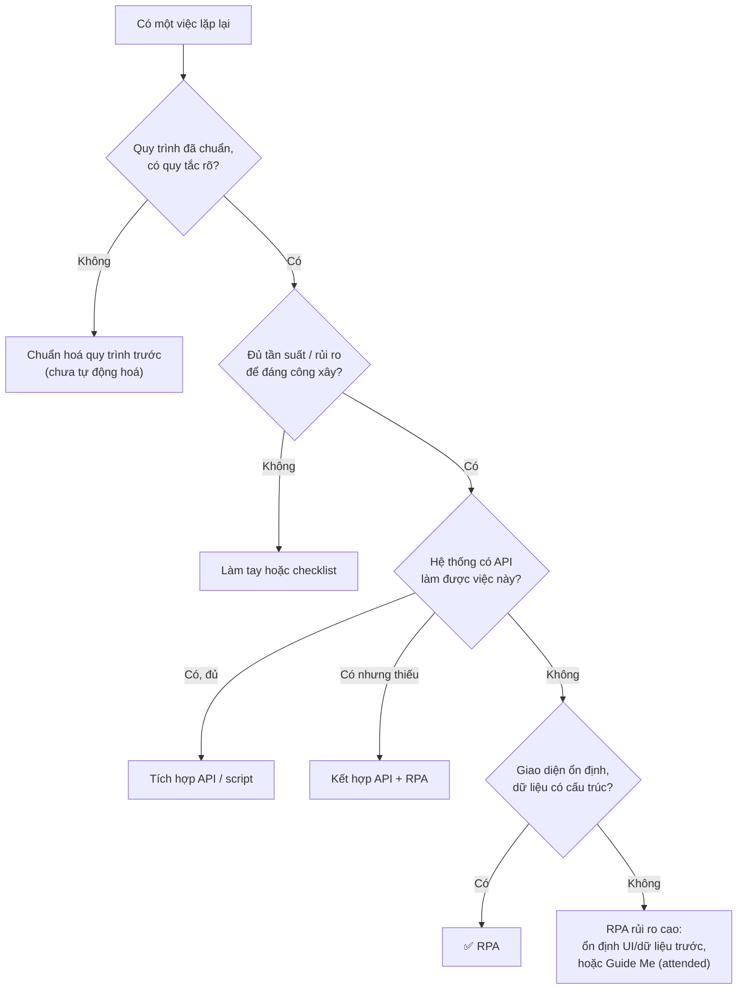

# Bài 01 — RPA là gì và khi nào nên dùng

> Module: 01-rpa-fundamentals · Thời lượng: ~75 phút · Cấp độ: L1→L2 · Cập nhật: 2026-11-16

## 1. Mục tiêu bài học
Sau bài này, bạn có thể:
- **Giải thích** RPA bằng lời của mình trong 2–3 câu, đủ để nói với leader.
- **Phân biệt** RPA với 3 cách tự động hoá khác: tích hợp API, workflow, script.
- **Quyết định** một việc có nên làm bằng RPA hay không, dựa trên 5 tiêu chí và một cây quyết định.
- **Nhận ra** các việc trong App Ops có thể tự động hoá, bắt đầu từ việc phân quyền user.

## 2. Tại sao cần học?
Leader của bạn quan tâm đến RPA. Câu đầu tiên leader sẽ hỏi thường là: *"Việc này có làm bằng RPA được không? Có đáng không?"*

Nếu chỉ biết bấm nút trong công cụ, bạn sẽ dễ tự động hoá **sai việc**: quá phức tạp, hay thay đổi, hoặc lẽ ra nên gọi API. Bot làm sai việc sẽ hỏng liên tục, và bạn mất điểm trong kỳ thử việc.

Biết **khi nào nên và khi nào không nên** dùng RPA là kỹ năng giúp bạn khác một người "biết dùng tool". Bài này là nền móng cho mọi bài sau.

## 3. Kiến thức cần có trước
- Không cần gì. Kinh nghiệm frontend của bạn sẽ giúp ích nhiều: DOM, sự kiện click, form, HTTP request, DevTools.

## 4. Giải thích khái niệm

### 4.1. RPA là gì?

**Ví dụ đời thường.** Hãy hình dung một nhân viên mới chỉ biết làm đúng một việc. Bạn chỉ cho họ: *"Mở trang admin → tìm user → tick vào role 'Viewer' → bấm Lưu → gửi email báo xong."* Họ làm lại y hệt, 200 lần mỗi ngày, không mệt, không gõ nhầm. Nhưng nếu nút "Lưu" bị đổi chỗ thì họ bối rối.

**RPA chính là "nhân viên" đó, nhưng là phần mềm.**

**Định nghĩa.** RPA (*Robotic Process Automation*, tự động hoá quy trình bằng robot phần mềm) dùng **software robot** (robot phần mềm, thường gọi tắt là **bot**) để tự động hoá các việc **lặp lại** và **có quy tắc rõ ràng**. Bot **bắt chước thao tác của con người trên giao diện**: click, gõ phím, đọc chữ trên màn hình, copy-paste giữa các ứng dụng.

> "Robot" ở đây **không phải** robot cơ khí. Đó là một chương trình chạy trên máy Windows và điều khiển chuột, bàn phím, trình duyệt, Excel... giống như một người đang ngồi trước máy.

**Ví dụ kỹ thuật.** Microsoft mô tả cách RPA hoạt động như sau:
1. Ghi lại (*record*) các bước người dùng thao tác trên giao diện ứng dụng.
2. Phát lại (*replay*) các bước đó, tức là "mô phỏng người dùng bằng phần mềm".

Trong Nintex RPA, kịch bản được ghi lại này gọi là **wizard**. Bạn tạo wizard trong **Nintex Studio**, rồi **robot** chạy wizard đó.

### 4.2. So sánh với thứ bạn đã biết (thế giới frontend)

Bạn từng viết code kiểu này trong Vue hoặc trong test:

```js
document.querySelector('#role-select').value = 'viewer';
document.querySelector('button.save').click();
```

Đoạn code trên điều khiển giao diện **từ bên trong** trang web. RPA làm việc tương tự nhưng **từ bên ngoài**:
- Bot không cần sửa code của app.
- Bot làm được trên **mọi ứng dụng có giao diện**: web, app desktop Windows, Excel, kể cả phần mềm cũ không có API.

Vì vậy RPA còn được gọi là **UI automation** (tự động hoá qua giao diện), phân biệt với **API automation** (tự động hoá qua API).

### 4.3. RPA khác gì các cách tự động hoá khác?

| Cách | Hoạt động thế nào | Ví dụ trong App Ops | Ưu điểm | Nhược điểm |
|---|---|---|---|---|
| **Tích hợp API** (*API integration*) | Chương trình gọi thẳng REST API của hệ thống | Script gọi `POST /users/123/roles` để gán quyền | Nhanh, ổn định, ít hỏng khi giao diện đổi | Hệ thống phải **có API** và cho phép dùng |
| **Script** (Python, PowerShell...) | Code tự viết xử lý file, dữ liệu, gọi API | Script đọc file Excel request, kiểm tra trùng lặp | Linh hoạt, miễn phí | Cần biết lập trình; khó cho người nghiệp vụ |
| **Workflow** (*quy trình phê duyệt*, vd Nintex Automation Cloud) | Điều phối các bước giữa **người** với người: form, phê duyệt, thông báo | Form xin quyền → quản lý duyệt → chuyển cho App Ops | Quản lý được luồng phê duyệt, có lịch sử | Không tự thao tác trên giao diện app khác |
| **RPA** | Bot thao tác giao diện như người | Bot mở web admin, tìm user, tick role, bấm Lưu | Làm được với app **không có API**; không cần sửa app | **Giòn** (*fragile*): giao diện đổi là bot hỏng; chậm hơn API |

Ý quan trọng nhất của bảng này là **các cách trên không loại trừ nhau, chúng thường kết hợp với nhau**:
- Workflow lo phần phê duyệt của con người.
- RPA hoặc API lo phần thao tác vào hệ thống.

Nintex có cả hai mảnh. Workflow nằm trong Nintex Automation Cloud, và Nintex Automation Cloud có sẵn action *"Start a Nintex RPA automation"* để gọi bot.

### 4.4. Khi nào NÊN dùng RPA? 5 tiêu chí

Tài liệu đào tạo của Microsoft liệt kê các đặc điểm của một quy trình tốt để tự động hoá. Các tiêu chí này đúng với mọi công cụ RPA, kể cả Nintex:

| Tiêu chí | Câu hỏi tự kiểm tra | Ví dụ "phân quyền user" |
|---|---|---|
| **Quy trình chuẩn** (*standard process*) | Mọi người có làm cùng một cách không? | ✅ Nếu có quy định rõ: role nào cần ai duyệt |
| **Tần suất cao** (*high frequency*) | Có lặp lại nhiều lần trong ngày hay tuần không? Có đáng công xây bot không (ROI)? | ✅ Nếu có hàng chục request mỗi tuần |
| **Kết quả dự đoán được** (*predictable*) | Có cần con người "phán đoán" không? | ✅ Có quy tắc; ⚠️ những request "đặc biệt" phải để người xử lý |
| **Dễ sai khi làm tay** (*prone to human error*) | Có dễ tick nhầm role, nhầm user không? | ✅ Tick nhầm role là lỗi bảo mật |
| **Rủi ro/tác động cao khi sai** | Sai thì hậu quả lớn không? Tự động hoá có giảm rủi ro không? | ✅ Cấp thừa quyền nguy hiểm, bot làm đúng quy tắc 100% |

Hai tiêu chí bổ sung **riêng cho RPA**, vì RPA làm việc qua giao diện:
- **Giao diện ổn định**: app ít đổi giao diện. Giao diện đổi liên tục thì bot hỏng liên tục.
- **Dữ liệu đầu vào có cấu trúc**: dữ liệu nằm trong Excel, form, các trường cố định. Email viết tự do kiểu *"cho em xin quyền như anh A"* thì bot khó hiểu.

### 4.5. Khi nào KHÔNG nên dùng RPA?

- **Hệ thống có API tốt**: gọi API thì nhanh và bền hơn. Microsoft khuyên dùng API trước, chỉ dùng RPA khi không có API.
- **Quy trình chưa ổn định** hoặc đang thay đổi: tự động hoá một quy trình lộn xộn sẽ tạo ra **một mớ lộn xộn chạy nhanh hơn**.
- **Cần phán đoán phức tạp**: ví dụ quyết định có nên cấp quyền admin cho một trường hợp đặc biệt không. Việc này để người làm, bot chỉ chuẩn bị dữ liệu.
- **Làm vài lần mỗi tháng và mỗi lần chỉ mất 2 phút**: công xây và bảo trì bot lớn hơn lợi ích.

Có một trường hợp lưng chừng, Microsoft cũng nhắc tới: **có API nhưng API không làm được hết những gì giao diện làm được**. Khi đó có thể kết hợp: phần nào có API thì gọi API, phần còn lại thì dùng RPA.

### 4.6. Cây quyết định



### 4.7. Hai "kiểu" robot (giới thiệu, sẽ học kỹ ở bài 02)

Theo tài liệu Nintex:
- **Unattended robot** (robot tự chạy): chạy trên máy ảo, làm việc 24/7 "phía sau hậu trường", không cần người. Robot nhận việc từ **Nintex Console Plus** hoặc **Nintex Public API**.
- **Attended robot** (robot có người đi kèm): chạy nền trên máy nhân viên. Nhân viên gọi robot ra khi cần, theo 2 chế độ:
  - **Do It**: robot tự làm thay.
  - **Guide Me**: robot hướng dẫn nhân viên làm từng bước.

### 4.8. Áp dụng vào việc của bạn: phân quyền user

Quy trình bạn đã quan sát ở công ty có dạng: *user gửi request → (có người duyệt?) → App Ops vào hệ thống gán quyền → báo lại user*.

Đây đúng là loại việc mà tài liệu Microsoft nêu làm ví dụ, gọi là ***new user onboarding***: thiết lập user trên nhiều hệ thống, trong đó *"some applications don't have available automation"*. Với những ứng dụng đó, bot thêm user và cấu hình qua giao diện.

Nhưng **trước khi** đề xuất với leader, bạn cần trả lời được 4 câu hỏi. Đây là bài tập quan sát trong tuần này, chỉ quan sát và ghi chép, không thử nghiệm gì trên hệ thống công ty:
1. Mỗi tuần có bao nhiêu request? Mỗi request mất bao nhiêu phút?
2. Request đến qua kênh nào: email, form, ticket, Excel?
3. Hệ thống được phân quyền là web, app desktop, hay có API?
4. Có bước phê duyệt không? Ai duyệt?

## 5. Thực hành từng bước
> Môi trường: trình duyệt Chrome/Edge trên máy cá nhân + giấy hoặc file ghi chú. Chi phí: miễn phí. Không dùng hệ thống hay dữ liệu công ty.

**Bước 1: Xem một trang web "nói chuyện" với API như thế nào (tận dụng kỹ năng frontend)**

1. Mở <https://jsonplaceholder.typicode.com/> (một API giả lập miễn phí, công khai).
2. Mở DevTools (`F12`), chọn tab **Network**, lọc **Fetch/XHR**.
3. Chuyển sang tab **Console**, gõ lệnh sau rồi Enter:
```js
fetch('https://jsonplaceholder.typicode.com/todos/1').then(r => r.json()).then(console.log)
```

Kết quả mong đợi: Console in ra object bên dưới. Quay lại tab Network sẽ thấy request `todos/1`, status `200`, response JSON:
```json
{
  "userId": 1,
  "id": 1,
  "title": "delectus aut autem",
  "completed": false
}
```
Giải thích: giao diện web hiện dữ liệu bằng cách **gọi API**. Khi trang admin ở công ty làm việc tương tự (giao diện gọi REST API phía sau), thì về lý thuyết có thể **tự động hoá qua API** thay vì RPA. Tuy vậy, việc gọi API của hệ thống công ty phải được **cho phép chính thức**: cần tài liệu API, tài khoản kỹ thuật, và sự đồng ý của chủ hệ thống. Thấy được request trong DevTools **không có nghĩa** là được phép gọi.

> ⚠️ Không mở DevTools để soi hệ thống nội bộ công ty khi chưa được phép, vì có thể vi phạm quy định bảo an. Bài này chỉ thực hành trên trang công khai.

**Bước 2: Áp dụng cây quyết định cho 6 tình huống**

Kẻ bảng sau ra giấy hoặc file, tự điền cột "Quyết định" và "Lý do", rồi so với gợi ý ở mục 9:

| # | Tình huống | Quyết định (RPA / API / Workflow / Không tự động hoá) | Lý do |
|---|---|---|---|
| A | Mỗi ngày 40 request phân quyền gửi qua form có sẵn trường cố định. Web admin cũ, không có API. | | |
| B | Như A, nhưng web admin có REST API chính thức, đội IT cấp tài khoản kỹ thuật. | | |
| C | Mỗi tháng 2 lần, xuất 1 báo cáo mất 3 phút. | | |
| D | Request gửi qua chat, viết tự do: "cho em quyền giống chị Lan". | | |
| E | Mỗi sáng kiểm tra 15 trang web nội bộ còn mở được không, chụp màn hình gửi nhóm. | | |
| F | Quy trình duyệt quyền đang được sếp thiết kế lại, tháng sau mới chốt. | | |

**Bước 3: Bắt đầu "nhật ký việc lặp lại" ở công ty**

Tạo một file ghi chú cá nhân, **không chứa dữ liệu công ty**: không tên user, không tên hệ thống nhạy cảm. Mỗi khi gặp một việc lặp lại, ghi 1 dòng theo mẫu:
```
Việc | Tần suất (lần/tuần) | Phút/lần | Kênh đầu vào | Loại hệ thống (web/desktop/API) | Có duyệt?
```
Mục tiêu: có ít nhất 5 dòng trước bài 05. Bài 05 dạy chấm điểm các việc này và chọn việc để đề xuất với leader.

## 6. Lỗi thường gặp
| Triệu chứng | Nguyên nhân | Cách xử lý |
|---|---|---|
| Bot "chạy được hôm qua, hôm nay hỏng" | Giao diện app thay đổi (đổi vị trí nút, đổi tên trường) → RPA giòn | Chọn app có giao diện ổn định; thiết kế nhận diện phần tử bền vững (bài 03); có giám sát + runbook |
| Bot làm nhanh nhưng kết quả sai hàng loạt | Tự động hoá một quy trình chưa chuẩn | Chuẩn hoá quy trình và viết PDD **trước** khi xây bot (bài 04) |
| Xây bot mất 2 tuần cho việc tốn 10 phút/tháng | Không tính ROI trước | Dùng tiêu chí "tần suất cao" + tính giờ tiết kiệm (bài 05) |
| Dùng RPA trong khi hệ thống có API tốt | Quen dùng một công cụ | Luôn hỏi "có API không?" trước (cây quyết định 4.6) |
| Bot cố "hiểu" email viết tự do và xử lý sai | Đầu vào không có cấu trúc | Chuẩn hoá đầu vào bằng form/template, hoặc để người phân loại trước |

## 7. Thuật ngữ
| Tiếng Anh | Nghĩa tiếng Việt | Giải thích ngắn |
|---|---|---|
| Software robot / bot | Robot phần mềm | Chương trình thao tác máy tính thay người |
| UI automation | Tự động hoá qua giao diện | Điều khiển app bằng cách click/gõ trên giao diện, như RPA |
| API integration | Tích hợp qua API | Các hệ thống trao đổi dữ liệu trực tiếp qua API, không qua giao diện |
| Rule-based | Dựa trên quy tắc | Việc có thể mô tả bằng "nếu… thì…", không cần phán đoán |
| Legacy application | Ứng dụng cũ (kế thừa) | Phần mềm cũ, thường không có API hiện đại |
| Fragile | Giòn, dễ vỡ | Dễ hỏng khi môi trường thay đổi nhỏ |
| ROI (Return on Investment) | Lợi tức đầu tư | Lợi ích thu được so với công sức/chi phí bỏ ra |
| Do It / Guide Me | Làm hộ / Hướng dẫn | Hai chế độ chạy wizard của attended robot Nintex |
| Nintex Studio | (giữ nguyên) | Công cụ để record và chỉnh sửa wizard |
| Nintex Console Plus | (giữ nguyên) | Nơi giao task cho unattended robot |

## 8. Đọc tài liệu gốc
> Nguồn: Microsoft Learn, *Introduction (Robotic process automation with Power Automate for desktop)*. <https://learn.microsoft.com/en-us/training/modules/robotic-process-automation/1-introduction>

**Đoạn trích (tiếng Anh):**
> Many legacy applications don't have a method for accessing their data or functionality except through their user interface. RPA solutions operate by generating a list of actions by capturing the steps that a user performs in an application's user interface. The RPA solution then performs the automation by repeating the steps in the application's UI, effectively simulating the user's actions in software. RPA enables the automation of applications that don't have an API that can be used for such automation tasks.

**Giải thích từng câu:**
1. *"Many legacy applications don't have a method for accessing their data or functionality except through their user interface."*
   - Dịch: Nhiều ứng dụng cũ không có cách nào để truy cập dữ liệu hay chức năng của chúng, ngoại trừ qua giao diện người dùng.
   - *legacy applications* = ứng dụng cũ · *method for accessing* = cách để truy cập · *except through* = ngoại trừ thông qua · *user interface (UI)* = giao diện người dùng.
2. *"RPA solutions operate by generating a list of actions by capturing the steps that a user performs in an application's user interface."*
   - Dịch: Các giải pháp RPA hoạt động bằng cách tạo ra một danh sách hành động, bằng cách ghi lại các bước mà người dùng thực hiện trên giao diện ứng dụng.
   - *operate by* = hoạt động bằng cách · *generating* = tạo ra · *capturing* = ghi lại, chụp lại · *performs* = thực hiện.
3. *"The RPA solution then performs the automation by repeating the steps in the application's UI, effectively simulating the user's actions in software."*
   - Dịch: Sau đó giải pháp RPA tự động hoá bằng cách lặp lại các bước đó trên giao diện, thực chất là mô phỏng hành động của người dùng bằng phần mềm.
   - *repeating* = lặp lại · *effectively* = về thực chất · *simulating* = mô phỏng.
4. *"RPA enables the automation of applications that don't have an API that can be used for such automation tasks."*
   - Dịch: RPA giúp tự động hoá được những ứng dụng không có API dùng được cho việc tự động hoá.
   - *enables* = cho phép, giúp làm được.

**Từ/cụm từ đáng nhớ:** *legacy*, *user interface (UI)*, *capture the steps*, *simulate*, *enable*.

## 9. Tự kiểm tra
1. Giải thích RPA cho leader của bạn trong 2 câu, không dùng chữ "robot".
2. Tình huống: web admin phân quyền có REST API chính thức, nhưng API **không** hỗ trợ chức năng "gán quyền theo nhóm". Chức năng này chỉ làm được trên giao diện. Bạn đề xuất cách tự động hoá nào?
3. Chuyện gì xảy ra nếu bạn xây bot RPA cho quy trình đang được sếp thiết kế lại (tình huống F)?
4. Điền bảng 6 tình huống ở Bước 2 mục 5.

<details><summary>Gợi ý đáp án (chỉ mở sau khi đã tự trả lời)</summary>

1. Ví dụ: "Đây là phần mềm thao tác trên giao diện app/web y như người: click, gõ, copy dữ liệu, theo đúng các bước mình ghi lại. Nó hợp với việc lặp lại, có quy tắc rõ, nhất là trên hệ thống không có API."
2. **Kết hợp**: phần nào API làm được thì gọi API (nhanh, bền); riêng "gán quyền theo nhóm" thì dùng RPA. Microsoft nêu đúng trường hợp này: API có nhưng không có đủ mọi thao tác như giao diện.
3. Bot sẽ phải sửa liên tục, hoặc tệ hơn là tự động hoá sai quy trình. Nên chờ quy trình chốt, viết PDD rồi mới xây.
4. Bảng tình huống:
   - A → **RPA**: tần suất cao, đầu vào có cấu trúc, không có API.
   - B → **API**: có API chính thức thì ưu tiên.
   - C → **Không tự động hoá**: ROI quá thấp.
   - D → **Chưa nên**: đầu vào không cấu trúc. Chuẩn hoá bằng form trước, hoặc dùng workflow để thu request.
   - E → **RPA** (hoặc script kiểm tra HTTP): lặp mỗi ngày, có quy tắc. Đây là việc App Ops điển hình.
   - F → **Chờ**: quy trình chưa ổn định.
</details>

## 10. Nguồn tham khảo
| Tài liệu | Phiên bản | Ngày truy cập |
|---|---|---|
| [Microsoft Learn: Introduction (RPA with Power Automate for desktop)](https://learn.microsoft.com/en-us/training/modules/robotic-process-automation/1-introduction) | ms.date 2024-12-02 | 2026-11-16 |
| [Microsoft Learn: Introduction to desktop flows](https://learn.microsoft.com/en-us/power-automate/desktop-flows/introduction) | ms.date 2026-08-23 | 2026-11-16 |
| [Nintex RPA Platform (help.nintex.com)](https://help.nintex.com/en-us/kryonrpa/22.03/Content/SystemArchitecture/RPA_Platform.htm) | Nintex RPA 22.03 (khái niệm vẫn đúng ở bản 25.11/26.6) | 2026-11-16 |
| [Nintex RPA product page](https://www.nintex.com/platforms/cloud-automation/rpa/) | — | 2026-11-16 |
| [UiPath: What is robotic process automation](https://www.uipath.com/rpa/robotic-process-automation) | — | 2026-11-16 |
| [Nintex: Start a Nintex RPA automation (Nintex Automation Cloud)](https://help.nintex.com/en-us/nwc/Content/Designer/Actions/NintexRPA-StartANintexRPAAutomation.htm) | — | 2026-11-16 |
