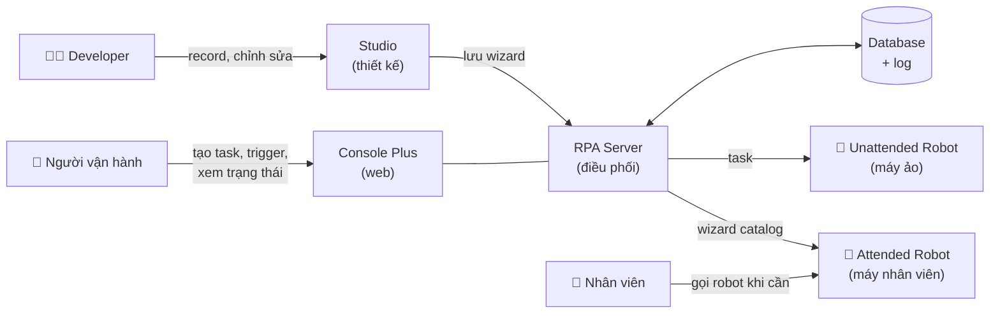
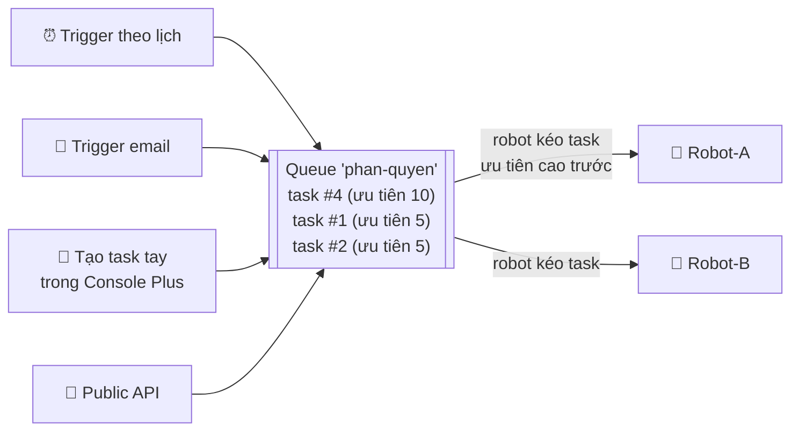
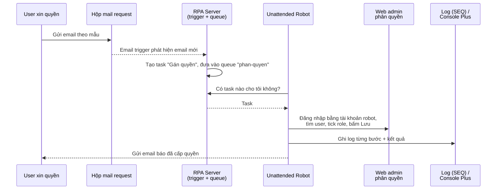

# Bài 02 — Kiến trúc nền tảng RPA

> Module: 01-rpa-fundamentals · Thời lượng: ~80 phút · Cấp độ: L1→L2 · Cập nhật: 2026-11-17

## 1. Mục tiêu bài học
Sau bài này, bạn có thể:
- **Kể tên và giải thích** 4 khối của mọi nền tảng RPA: nơi thiết kế (Studio), nơi chạy (Robot), nơi điều phối (Server/Orchestrator), nơi lưu trữ (Database + log).
- **Phân biệt** attended robot và unattended robot: chạy ở đâu, ai kích hoạt, dùng khi nào.
- **Giải thích** cách việc đi tới robot: **trigger** tạo **task** → task nằm trong **queue** → robot **kéo** task về chạy.
- **Ánh xạ** các thành phần của Nintex RPA sang UiPath và Power Automate.
- **Vẽ** luồng một bot "phân quyền user" chạy trên nền tảng Nintex, từ lúc có request tới lúc báo kết quả.

## 2. Tại sao cần học?
Bài 01 trả lời câu hỏi "RPA là gì". Bài này trả lời câu hỏi tiếp theo: **"Bot chạy ở đâu, ai bấm nút cho nó chạy, và khi hỏng thì xem ở đâu?"**

Trong vai trò App Ops, bạn không chỉ *viết* bot. Bạn còn phải *vận hành* bot. Khi leader hỏi *"Sáng nay sao bot không chạy?"*, bạn cần biết nên nhìn vào chỗ nào: robot bị mất kết nối? task kẹt trong queue? hay trigger chưa bật?

Nếu chỉ biết Studio, bạn sẽ giống một dev frontend chỉ biết viết component mà không biết app được build, deploy và chạy trên server như thế nào. Viết được, nhưng không vận hành được.

Bài này cũng giúp bạn nói chuyện với đội hạ tầng (infra) khi xin quyền Nintex: biết cần xin **cái gì** (Studio? Robot? quyền vào Console?).

## 3. Kiến thức cần có trước
- Bài 01 — RPA là gì và khi nào nên dùng: [`01-rpa-la-gi.md`](01-rpa-la-gi.md), đặc biệt mục 4.7 (hai kiểu robot).
- Từ nền frontend: bạn đã biết build tool, deploy, server, browser. Bài này sẽ so sánh với những thứ đó.

## 4. Giải thích khái niệm

### 4.1. Vì sao một nền tảng RPA có nhiều thành phần?

**Ví dụ đời thường: một nhà hàng.**
- **Bếp trưởng** viết công thức món ăn.
- **Đầu bếp** nấu theo công thức.
- **Quầy nhận order** ghi món khách gọi lên bảng, món nào gấp thì xếp lên trước. Đầu bếp nào rảnh thì lấy order tiếp theo.
- **Sổ sách** ghi lại món nào đã nấu, món nào bị khách trả lại.

Một nhà hàng nhỏ có thể chỉ có một người làm hết. Nhưng khi có 200 order mỗi ngày, ta phải tách vai trò ra.

RPA cũng vậy. Một bot chạy thử trên máy bạn thì đơn giản. Nhưng khi công ty có hàng chục bot, chạy hằng ngày, cần biết bot nào chạy lúc nào và hỏng ở đâu, thì cần một **nền tảng** (*platform*) gồm nhiều thành phần.

### 4.2. Bốn khối chung của mọi nền tảng RPA

| Khối | Nhà hàng | Vai trò | Trong Nintex RPA |
|---|---|---|---|
| **Thiết kế** (*design*) | Bếp trưởng viết công thức | Nơi developer tạo kịch bản bot | **Nintex Studio** → tạo ra **wizard** |
| **Thực thi** (*execution*) | Đầu bếp | Chương trình chạy kịch bản trên một máy Windows | **Attended / Unattended Robot** |
| **Điều phối** (*orchestration*) | Quầy order + bảng order | Giao việc cho robot, xếp ưu tiên, lên lịch, theo dõi | **RPA Server** + **Console Plus** |
| **Lưu trữ & log** | Sổ sách | Lưu wizard, cấu hình, lịch sử chạy, log | **Database** (SQL Server) + log server **SEQ** |

**So với thế giới frontend của bạn:**
- Studio giống **VS Code**: nơi bạn viết code.
- Wizard giống **bản build** của app: thứ thực sự được đem đi chạy.
- Robot giống **trình duyệt** chạy app của bạn: nó là môi trường thực thi.
- Server/Console giống **hệ thống CI/CD + server deploy**: quyết định bản nào chạy ở đâu, khi nào, và cho bạn xem trạng thái.

Từ **orchestration** (*điều phối*, nghĩa gốc là "phối khí cho dàn nhạc") được dùng ở mọi nền tảng RPA. Người nhạc trưởng không chơi nhạc cụ nào, nhưng quyết định ai chơi, chơi lúc nào.



### 4.3. Khối thực thi: attended và unattended robot

Bài 01 đã giới thiệu hai kiểu robot. Bây giờ ta đi sâu hơn.

#### Unattended robot (robot tự chạy)

**Định nghĩa.** Robot chạy **không cần người** ngồi trước máy. Theo tài liệu Nintex, unattended robot chạy trên **máy ảo** (*virtual machine*, VM), làm việc *"24/7 behind the scenes"* (24/7, phía sau hậu trường) cho các quy trình **khối lượng lớn, lặp lại**.

**Ví dụ đời thường.** Một ca làm đêm trong nhà máy: không ai đứng giám sát, máy cứ chạy theo lệnh đã giao.

**Cách nó nhận việc (Nintex):**
1. Ai đó (hoặc một trigger, xem 4.4) tạo **task** trong **Console Plus**, hoặc qua **Nintex Public API**.
2. Mỗi task gọi một **wizard**. Wizard cho robot biết chính xác từng bước phải làm.
3. Wizard chạy ở **robotic mode** (chế độ robot), không cần con người can thiệp.

**Điều cần nhớ khi vận hành.** Tài liệu Power Automate nêu khá rõ những gì xảy ra với máy chạy unattended. Các ý sau đúng với nguyên lý chung của unattended robot:
- Nền tảng **tự đăng nhập** vào máy bằng một tài khoản đã cấu hình, chạy xong thì đăng xuất.
- Màn hình máy bị **khoá** trong lúc chạy, nên không ai nhìn thấy bot làm gì.
- Với Power Automate, máy Windows 10/11 **không chạy được** unattended nếu đang có người đăng nhập (kể cả phiên đã khoá màn hình).
- **Độ phân giải màn hình** của phiên unattended có thể khác lúc bạn record. Kết quả: bot không tìm thấy nút, hoặc tệ hơn, **click nhầm phần tử**.

UiPath thì khuyên unattended robot chạy bằng **robot account**: một tài khoản riêng dành cho robot, không dùng tài khoản cá nhân của nhân viên.

> 💡 Ý nghĩa với App Ops: bot unattended dùng **tài khoản riêng** để đăng nhập hệ thống. Tài khoản đó cần được cấp quyền đúng mức, và mật khẩu cần được bảo vệ. Bạn sẽ học cách bảo vệ ở bài 06 và module 05 (Credentials Vault).

#### Attended robot (robot có người đi kèm)

**Định nghĩa.** Robot chạy **nền** trên **máy của nhân viên**, giúp nhân viên khi họ cần. UiPath mô tả attended robot như *"personal assistants"* (trợ lý cá nhân) cho người dùng cuối.

**Ví dụ đời thường.** Trợ lý ngồi cạnh bạn: bạn nhờ thì họ làm, bạn không nhờ thì họ ngồi yên.

**Hai cách gọi attended robot trong Nintex:**
1. **Nhân viên tự gọi**: mở robot, tìm wizard trong **catalog** (danh mục wizard), chọn chạy theo một trong hai chế độ:
   - **Do It**: robot tự thao tác thay nhân viên.
   - **Guide Me**: robot chỉ cho nhân viên từng chỗ cần click hoặc gõ.
2. **Sensor** (cảm biến): robot nằm im dưới thanh taskbar của Windows. Khi nhân viên mở **một ứng dụng hoặc một màn hình cụ thể**, sensor phát hiện và robot "thức dậy". Lúc đó robot đưa ra trợ giúp đúng ngữ cảnh, hoặc **kiểm tra dữ liệu** (*data validation*) nhân viên vừa nhập.

**So với frontend.** Sensor giống một **event listener**: `window.addEventListener('...')` chờ sự kiện xảy ra rồi mới chạy hàm xử lý. Chỉ khác là sự kiện ở đây là "người dùng mở màn hình X".

**Điều cần nhớ:** attended robot chạy **dưới tài khoản của nhân viên**, nên có **đúng quyền** của nhân viên đó (UiPath ghi rõ điều này). Nhân viên không có quyền gán role thì attended robot trên máy họ cũng không làm được.

#### So sánh

| | Unattended robot | Attended robot |
|---|---|---|
| Chạy ở đâu | Máy ảo / máy riêng cho robot | Máy của nhân viên |
| Ai kích hoạt | Console Plus, trigger, Public API | Nhân viên (Do It / Guide Me) hoặc sensor |
| Có người nhìn không | Không, màn hình thường bị khoá | Có, nhân viên ngồi trước máy |
| Chạy bằng tài khoản nào | Tài khoản riêng của robot | Tài khoản của nhân viên |
| Hợp với việc | Khối lượng lớn, lặp lại, chạy theo lịch/hàng đợi | Việc nhỏ, cần người quyết định giữa chừng, cần hướng dẫn |
| Ví dụ App Ops | Mỗi sáng 7h kiểm tra 15 trang web còn sống không | Nhân viên App Ops nhận request lạ, gọi robot "Do It" để làm phần nhập liệu, còn quyết định cấp quyền thì người làm |

### 4.4. Khối điều phối: trigger → task → queue → robot

Đây là phần quan trọng nhất cho người vận hành. Ta dùng đúng thuật ngữ của **Console Plus** (bảng điều khiển web của Nintex RPA).

**Task (nhiệm vụ)** = một lần chạy wizard cụ thể. Ví dụ: "chạy wizard *Gán quyền Viewer* cho user An".

**Queue (hàng đợi)** = danh sách các task đang chờ được làm.
- Ví dụ đời thường: hàng người xếp lấy số ở ngân hàng.
- Từ Console Plus (bản 21.4 trở đi), Nintex chuyển từ "giao việc cho nhóm robot" sang "**robot làm việc cho queue**".
- Một robot có thể gán vào **nhiều queue**. Ví dụ: một robot vừa làm cho phòng Nhân sự vừa làm cho phòng Kế toán.

**Robot kéo việc, không phải bị đẩy việc** (*pull*, không phải *push*). Robot tự hỏi các queue mà nó được gán: "Có task nào cho tôi không?", rồi lấy task phù hợp về chạy. Hệ quả quan trọng: **robot không được gán vào queue nào thì không bao giờ nhận task của queue đó**, dù robot đang rảnh.

**Priority (độ ưu tiên).** Release notes bản 21.4 ghi thang ưu tiên từ **10 (cao nhất) đến 1 (thấp nhất)**, và có thể đổi ưu tiên bất kỳ lúc nào, kể cả chọn "Run Immediately" (chạy ngay). Lưu ý: các bản tài liệu khác nhau mô tả thang ưu tiên hơi khác nhau. Khi được cấp quyền, hãy kiểm tra trên đúng phiên bản công ty dùng.

**Trigger (bộ kích hoạt)** = *"a mechanism that creates tasks"*, tức cơ chế **tự tạo task**. Có hai loại:

| Loại | Khi nào tạo task | Ví dụ App Ops |
|---|---|---|
| **Time-based** (theo thời gian) | Theo lịch: mỗi vài phút, mỗi ngày, mỗi tháng... | 7h sáng mỗi ngày chạy wizard kiểm tra web |
| **Event-based** (theo sự kiện) — **File** | Khi một file được tạo, sửa hoặc xoá | Có file `request-phan-quyen.xlsx` mới trong thư mục chung |
| Event-based — **Folder** | Khi một thư mục được tạo hoặc xoá | |
| Event-based — **Email** | Khi nhận được email | Có email request phân quyền mới |
| Event-based — **Database** | Khi bản ghi trong database được thêm, sửa, xoá | Có dòng request mới trong bảng `access_requests` |

**So với frontend.** Bạn có thể liên tưởng tới **task queue trong event loop** của JavaScript: các callback xếp hàng chờ, và khi call stack rảnh thì lấy callback tiếp theo ra chạy. Trigger giống `setInterval` (theo thời gian) hoặc `addEventListener` (theo sự kiện).

**Trạng thái robot** trong Console Plus: **Idle** (rảnh), **Running** (đang chạy), **Stopped** (đã dừng), **Disconnected** (mất kết nối với server; bản cũ gọi là "ghost").



**Thêm một robot mới vào hệ thống (Nintex 23.11).** Robot mới cài xong sẽ ở trạng thái **chờ duyệt**. Quản trị viên phải **duyệt** (*approve*) robot trong Console, **gán robot vào queue**, rồi robot mới bắt đầu nhận task. Đây là một điểm hay bị quên khi triển khai.

### 4.5. Toàn cảnh Nintex RPA

Trang *System Architecture* (bản 25.11) viết: *"The Nintex RPA platform is comprised of the on-premises RPA Server, Database, and applications"*. Nghĩa là nền tảng gồm RPA Server và Database cài **on-premises** (tại máy chủ của công ty, không phải cloud của Nintex), cộng với các ứng dụng sau:

| Thành phần | Cài ở đâu | Làm gì |
|---|---|---|
| **RPA Server** | Windows Server của công ty | Trung tâm: lưu wizard, điều phối task, kết nối mọi thành phần |
| **Database** | SQL Server | Lưu dữ liệu của nền tảng |
| **Nintex Studio** | Máy developer (và trên server) | Record, chỉnh sửa wizard |
| **Unattended Robot** | Máy ảo | Chạy task không cần người |
| **Attended Robot** | Máy nhân viên | Chạy wizard khi nhân viên gọi hoặc sensor kích hoạt |
| **Console Plus** | Web, truy cập qua trình duyệt | Quản lý Tasks, Triggers, Robots, queue; có Dashboard thống kê |
| **Admin Tool** | Trên server | License, Credentials Vault, ứng dụng, user (đồng bộ user) |
| **SEQ** | Trên server (mặc định) | Log server: lưu log để tra cứu khi có sự cố |
| **Nintex Public API** | (API của server) | Cho hệ thống khác tạo task thay vì tạo tay trong Console |

> ⚠️ **Hệ quả thực tế cho bạn**: Studio cài một mình **không đủ** để học. Studio cần kết nối tới một RPA Server có license. Đó là lý do bạn cần xin công ty quyền truy cập Studio + server dev/test (việc đang chờ trước ngày 2026-11-29).

Nintex còn có sản phẩm workflow trên cloud là **Nintex Automation Cloud** (NAC). NAC có thể **gọi bot RPA** như một bước trong workflow. Phần này học ở module 06; hiện tại bạn chỉ cần biết nó là một "nguồn tạo task" nữa, giống Public API.

### 4.6. Ánh xạ sang UiPath và Power Automate

Các nền tảng đặt tên khác nhau, nhưng có cùng 4 khối. Học Nintex xong, sang giai đoạn 2 học UiPath hay Power Automate bạn chỉ cần "đổi tên".

| Khối | Nintex RPA | UiPath | Power Automate (Microsoft) |
|---|---|---|---|
| Thiết kế | Nintex Studio | UiPath Studio | Power Automate for desktop (trình thiết kế) |
| Kịch bản bot | Wizard | Process (gói package) | Desktop flow |
| Thực thi | Attended / Unattended Robot | Attended / Unattended Robot | Machine (máy cài Power Automate for desktop), chạy chế độ attended / unattended |
| Điều phối | RPA Server + Console Plus | Orchestrator (web) | Cổng web Power Automate (cloud flow, machine, machine group, monitor) |
| Hàng đợi | Queue | Queue | Work queue |
| Gọi từ hệ thống khác | Nintex Public API | Orchestrator API | Cloud flow gọi desktop flow |
| Cài đặt server | On-premises (Windows Server + SQL Server) | Cloud hoặc tự cài (standalone) | Cloud của Microsoft |

UiPath định nghĩa Orchestrator là *"a web application that enables you to orchestrate solutions, processes and robots"* (ứng dụng web giúp điều phối giải pháp, quy trình và robot). Trong danh sách chức năng có **Queues**: *"ensures automatic workload distribution across runtimes and Robots"* (tự động phân chia khối lượng công việc cho các robot). Đây chính là vai trò của Console Plus + queue trong Nintex.

### 4.7. Ghép lại: bot "phân quyền user" chạy thế nào?

Giả sử sau này bạn xây bot cho quy trình phân quyền, dùng unattended robot:



Khi bot hỏng, bạn đi ngược sơ đồ để tìm chỗ hỏng:
1. Email có tới không? → Trigger có đang bật không?
2. Task có được tạo không? → Task có kẹt trong queue không?
3. Robot có **Idle/Running** không, hay **Disconnected**? Robot có được gán vào queue `phan-quyen` không?
4. Robot đã chạy nhưng thất bại? → Xem log để biết bước nào lỗi.

Bạn sẽ dùng đúng "bản đồ" này ở module 06 (giám sát & xử lý sự cố bot).

## 5. Thực hành từng bước
> Môi trường: máy cá nhân (Windows hoặc Mac) có **Node.js** (bạn đã có). Chi phí: miễn phí. Không dùng hệ thống hay dữ liệu công ty.
>
> Vì chưa có quyền Nintex, ta **mô phỏng** khối điều phối bằng một script JavaScript nhỏ. Mục tiêu: *thấy tận mắt* trigger, queue, priority và robot kéo task hoạt động thế nào. Đây là mô hình đơn giản hoá, không phải cách Nintex được lập trình bên trong.

**Bước 1 — Tạo thư mục lab và file script**

```bash
mkdir lc-lab
cd lc-lab
```

Tạo file `lc-queue-sim.js` với nội dung sau (đọc kỹ các comment, chúng ánh xạ tới thuật ngữ trong bài):

```js
// lc-queue-sim.js — Mô phỏng (rất đơn giản) cách RPA Server + Console Plus giao việc cho robot
// Trigger tạo task -> task nằm trong queue -> robot tự KÉO task từ queue -> chạy wizard -> báo kết quả

// 1) Các queue (hàng đợi) — tạo trong Console Plus
const queues = { 'phan-quyen': [], 'bao-cao': [] };

// 2) Các unattended robot — mỗi robot được gán vào 1 hoặc nhiều queue
const robots = [
  { name: 'Robot-A', queues: ['phan-quyen'] },
  { name: 'Robot-B', queues: ['phan-quyen', 'bao-cao'] },
];

// 3) Trigger: cơ chế tạo task (theo lịch, hoặc khi có email/file mới...)
let nextId = 1;
function trigger(queue, wizard, priority, input) {
  const task = { id: nextId++, wizard, priority, input, status: 'Queued' };
  queues[queue].push(task);
  console.log(`[TRIGGER] Task #${task.id} "${wizard}" (priority ${priority}) -> queue "${queue}"`);
}

// 4) Robot hỏi các queue của mình, lấy task có priority cao nhất (10 = cao nhất)
function pullTask(robot) {
  let best = null, bestQueue = null;
  for (const q of robot.queues) {
    for (const t of queues[q]) {
      if (!best || t.priority > best.priority) { best = t; bestQueue = q; }
    }
  }
  if (best) queues[bestQueue] = queues[bestQueue].filter(t => t !== best);
  return best;
}

// 5) "Chạy wizard": ở đây chỉ giả lập — user không tồn tại thì thất bại
function runWizard(robot, task) {
  task.status = task.input === 'user-khong-ton-tai' ? 'Failed' : 'Completed';
  console.log(`  ${robot.name} chạy task #${task.id} "${task.wizard}" (${task.input}) -> ${task.status}`);
}

// ---- Kịch bản ----
trigger('phan-quyen', 'Gan quyen Viewer', 5, 'user-an');
trigger('phan-quyen', 'Gan quyen Viewer', 5, 'user-khong-ton-tai');
trigger('bao-cao', 'Xuat bao cao ngay', 3, 'bao-cao-17-11');
trigger('phan-quyen', 'Thu hoi quyen GAP', 10, 'user-binh');

for (let round = 1; round <= 3; round++) {
  console.log(`--- Vòng ${round} ---`);
  for (const robot of robots) {
    const task = pullTask(robot);
    if (task) runWizard(robot, task);
    else console.log(`  ${robot.name}: Idle (không có task trong queue của mình)`);
  }
}
const left = Object.entries(queues).filter(([, ts]) => ts.length).map(([q, ts]) => `${q}: ${ts.length}`);
console.log(`Còn lại trong queue: ${left.length ? left.join(', ') : 'không còn task nào'}`);
```

**Bước 2 — Chạy script**

```bash
node lc-queue-sim.js
```

Kết quả mong đợi (đã chạy thử với Node v24):
```
[TRIGGER] Task #1 "Gan quyen Viewer" (priority 5) -> queue "phan-quyen"
[TRIGGER] Task #2 "Gan quyen Viewer" (priority 5) -> queue "phan-quyen"
[TRIGGER] Task #3 "Xuat bao cao ngay" (priority 3) -> queue "bao-cao"
[TRIGGER] Task #4 "Thu hoi quyen GAP" (priority 10) -> queue "phan-quyen"
--- Vòng 1 ---
  Robot-A chạy task #4 "Thu hoi quyen GAP" (user-binh) -> Completed
  Robot-B chạy task #1 "Gan quyen Viewer" (user-an) -> Completed
--- Vòng 2 ---
  Robot-A chạy task #2 "Gan quyen Viewer" (user-khong-ton-tai) -> Failed
  Robot-B chạy task #3 "Xuat bao cao ngay" (bao-cao-17-11) -> Completed
--- Vòng 3 ---
  Robot-A: Idle (không có task trong queue của mình)
  Robot-B: Idle (không có task trong queue của mình)
Còn lại trong queue: không còn task nào
```

Giải thích:
- Task #4 được tạo **sau cùng** nhưng chạy **đầu tiên**, vì priority 10 cao nhất. Đây là lý do việc "thu hồi quyền gấp" nên có ưu tiên cao.
- Chỉ **Robot-B** chạy task báo cáo, vì chỉ Robot-B được gán vào queue `bao-cao`.
- Task #2 **Failed** nhưng robot vẫn tiếp tục làm task khác. Task lỗi cần người xem lại, đây là việc của App Ops.

**Bước 3 — Thí nghiệm "chuyện gì xảy ra nếu"**

Làm lần lượt từng thay đổi, chạy lại `node lc-queue-sim.js`, ghi lại kết quả, rồi **hoàn tác** trước khi làm thay đổi tiếp theo:

| # | Thay đổi | Bạn dự đoán gì? (ghi trước khi chạy) | Kết quả thực tế |
|---|---|---|---|
| a | Ở Robot-B, đổi `['phan-quyen', 'bao-cao']` thành `['phan-quyen']` | | |
| b | Đổi priority của task #4 từ `10` thành `1` | | |
| c | Thêm robot thứ ba: `{ name: 'Robot-C', queues: [] }` | | |
| d | Thêm 4 task `phan-quyen` nữa nhưng giữ `round <= 3` | | |

Gợi ý đối chiếu: thay đổi (a) sẽ in ra dòng cuối `Còn lại trong queue: bao-cao: 1`. Hãy tự giải thích vì sao, rồi liên hệ với mục 4.4.

**Bước 4 — Vẽ kiến trúc RPA ở công ty (chỉ quan sát và hỏi, không thử nghiệm)**

Khi có dịp nói chuyện với leader hoặc đội đang quản lý Nintex, hỏi thêm vài câu để vẽ được sơ đồ giống mục 4.2 cho công ty mình. Ghi vào file ghi chú cá nhân, **không ghi tên server, IP, tài khoản**:
1. Công ty dùng Nintex RPA bản nào (vd 24.4, 25.11, 26.6)?
2. Có môi trường **dev/test** tách riêng với **production** không?
3. Bot hiện có chạy **unattended** (máy ảo riêng) hay **attended** (máy nhân viên)?
4. Ai là người duyệt robot mới và quản lý queue trong Console Plus?

**Dọn dẹp:** script chỉ in ra màn hình, không tạo tài nguyên gì. Khi học xong có thể xoá thư mục `lc-lab` (hoặc giữ lại để ôn).

## 6. Lỗi thường gặp
| Triệu chứng / thông báo lỗi | Nguyên nhân | Cách xử lý |
|---|---|---|
| Task nằm mãi trong queue, robot vẫn **Idle** | Robot không được gán vào queue đó (giống thí nghiệm a); hoặc robot mới chưa được duyệt | Trong Console Plus: kiểm tra robot đã được approve và gán đúng queue |
| Robot hiện **Disconnected** | Robot mất kết nối với RPA Server: máy robot tắt, mạng lỗi, dịch vụ trên server dừng | Kiểm tra máy robot còn chạy, kết nối mạng tới server; báo đội infra nếu server có vấn đề |
| Bot không chạy theo lịch sau khi nâng cấp | Khi nâng cấp từ console cũ lên Console Plus, các trigger bị chuyển sang **inactive** (theo tài liệu migration) | Rà lại danh sách trigger, bật lại những trigger cần dùng |
| Bot unattended không chạy, trong khi chạy attended thì được | Có người đang đăng nhập máy robot (Power Automate ghi rõ trường hợp này trên Windows 10/11) | Đăng xuất mọi user khỏi máy robot; không dùng máy robot để làm việc khác |
| Bot unattended click hụt hoặc click nhầm, dù test trên máy mình thì ổn | Độ phân giải màn hình phiên unattended khác lúc record | Đặt độ phân giải cố định cho máy robot, giống lúc record (học kỹ ở bài 03) |
| Studio báo "Cannot access Nintex Servers" | Studio không kết nối được tới RPA Server có license | Cần thông tin server + quyền từ công ty; Studio không chạy độc lập được |
| Attended robot báo không đủ quyền | Attended robot chạy bằng tài khoản nhân viên, có đúng quyền của nhân viên đó | Xin quyền cho tài khoản nhân viên, hoặc chuyển sang unattended với tài khoản robot được cấp quyền phù hợp |

## 7. Thuật ngữ
| Tiếng Anh | Nghĩa tiếng Việt | Giải thích ngắn |
|---|---|---|
| Platform | Nền tảng | Tập hợp các thành phần phối hợp để xây, chạy, quản lý bot |
| Orchestration / Orchestrator | Điều phối / Bộ điều phối | Giao việc cho robot, xếp ưu tiên, lên lịch, theo dõi |
| RPA Server | Máy chủ RPA | Trung tâm của Nintex RPA, cài on-premises |
| On-premises | Tại chỗ | Cài trên máy chủ của công ty, không phải cloud của nhà cung cấp |
| Task | Nhiệm vụ | Một lần chạy một wizard cụ thể |
| Queue | Hàng đợi | Danh sách task chờ robot lấy về chạy |
| Trigger (time-based / event-based) | Bộ kích hoạt (theo thời gian / theo sự kiện) | Cơ chế tự động tạo task |
| Priority | Độ ưu tiên | Task ưu tiên cao được chạy trước |
| Pull model | Mô hình kéo | Robot tự hỏi queue và lấy task, không bị server đẩy task tới |
| Sensor | Cảm biến | Attended robot tự kích hoạt khi nhân viên mở một app/màn hình cụ thể |
| Wizard catalog | Danh mục wizard | Danh sách wizard nhân viên chọn để chạy trên attended robot |
| Idle / Running / Stopped / Disconnected | Rảnh / Đang chạy / Đã dừng / Mất kết nối | Trạng thái robot trong Console Plus |
| Virtual machine (VM) | Máy ảo | Máy tính chạy bằng phần mềm trên máy thật; nơi thường đặt unattended robot |
| Robot account | Tài khoản robot | Tài khoản riêng cho robot đăng nhập hệ thống, không dùng tài khoản cá nhân |
| Admin Tool | Công cụ quản trị | Quản lý license, Credentials Vault, user của Nintex RPA |
| SEQ | (giữ nguyên) | Log server đi kèm Nintex RPA |
| Nintex Public API | API công khai của Nintex | Cho hệ thống khác tạo task cho robot |
| UiPath Orchestrator | (giữ nguyên) | Bộ điều phối web của UiPath, tương đương Console Plus |
| Desktop flow / Cloud flow | Luồng desktop / Luồng cloud | Trong Power Automate: bot RPA chạy trên máy / workflow chạy trên cloud |
| Work queue | Hàng đợi công việc | Tên gọi queue trong Power Automate |

## 8. Đọc tài liệu gốc
> Nguồn: Nintex RPA Platform — Introduction (bản 22.03). <https://help.nintex.com/en-us/kryonrpa/22.03/Content/SystemArchitecture/RPA_Platform.htm>

**Đoạn trích (tiếng Anh):**
> Nintex unattended robots run on virtual machines, working 24/7 behind the scenes to automate high-volume, repetitive, time-consuming business processes. In an unattended automation context: Robots are assigned tasks via Nintex Console Plus (or via the Nintex Public API). Each task invokes a wizard, which provides the robot with a precise set of instructions for completing the task. The wizard runs automatically in robotic mode, without the need for human intervention.

**Giải thích từng câu:**
1. *"Nintex unattended robots run on virtual machines, working 24/7 behind the scenes to automate high-volume, repetitive, time-consuming business processes."*
   - Dịch: Robot unattended của Nintex chạy trên máy ảo, làm việc 24/7 phía sau hậu trường để tự động hoá các quy trình nghiệp vụ khối lượng lớn, lặp lại và tốn thời gian.
   - *virtual machines* = máy ảo · *behind the scenes* = phía sau hậu trường (không ai nhìn thấy) · *high-volume* = khối lượng lớn · *repetitive* = lặp đi lặp lại · *time-consuming* = tốn thời gian.
2. *"In an unattended automation context: Robots are assigned tasks via Nintex Console Plus (or via the Nintex Public API)."*
   - Dịch: Trong bối cảnh tự động hoá không người giám sát, robot được giao task qua Nintex Console Plus (hoặc qua Nintex Public API).
   - *context* = bối cảnh · *are assigned* = được giao (bị động của *assign*) · *via* = thông qua.
3. *"Each task invokes a wizard, which provides the robot with a precise set of instructions for completing the task."*
   - Dịch: Mỗi task gọi một wizard; wizard cung cấp cho robot một bộ chỉ dẫn chính xác để hoàn thành task.
   - *invokes* = gọi, kích hoạt (giống "invoke a function" trong lập trình) · *provides A with B* = cung cấp B cho A · *precise* = chính xác · *a set of instructions* = một bộ chỉ dẫn.
4. *"The wizard runs automatically in robotic mode, without the need for human intervention."*
   - Dịch: Wizard tự động chạy ở chế độ robot, không cần con người can thiệp.
   - *automatically* = một cách tự động · *without the need for* = mà không cần · *intervention* = sự can thiệp.

**Từ/cụm từ đáng nhớ:** *behind the scenes*, *high-volume*, *be assigned*, *via*, *invoke*, *precise*, *intervention*.

## 9. Tự kiểm tra
1. Kể tên 4 khối của một nền tảng RPA và thành phần Nintex tương ứng với mỗi khối.
2. Tình huống: mỗi sáng 7h cần kiểm tra 15 trang web nội bộ còn mở được không, rồi gửi kết quả vào nhóm chat. Bạn chọn attended hay unattended robot? Dùng loại trigger nào?
3. Chuyện gì xảy ra nếu bạn cài thêm một unattended robot mới nhưng quên gán nó vào queue nào?
4. Đồng nghiệp nói: "Cài Nintex Studio trên máy mình là đủ để làm và chạy bot rồi". Đúng hay sai? Vì sao?

<details><summary>Gợi ý đáp án (chỉ mở sau khi đã tự trả lời)</summary>

1. Thiết kế → **Nintex Studio** (tạo wizard). Thực thi → **Attended / Unattended Robot**. Điều phối → **RPA Server + Console Plus** (task, trigger, queue). Lưu trữ & log → **Database (SQL Server) + SEQ**.
2. **Unattended**: việc lặp lại, chạy theo giờ cố định, không cần người quyết định. Dùng **time-based trigger** (theo lịch, 7h mỗi ngày). Task được đưa vào một queue có robot được gán.
3. Robot đó **không bao giờ nhận task**, vì robot kéo task từ những queue nó được gán. Trên Console Plus robot vẫn hiện Idle, trông như "đang rảnh nhưng không làm". Ngoài ra robot mới còn phải được **duyệt** (approve) trước.
4. **Sai.** Studio chỉ là khối thiết kế. Wizard được lưu trên **RPA Server**; Studio cần kết nối tới RPA Server có license (nếu không sẽ gặp lỗi kiểu "Cannot access Nintex Servers"). Muốn chạy tự động theo lịch/hàng đợi thì còn cần robot + Console Plus.
</details>

## 10. Nguồn tham khảo
| Tài liệu | Phiên bản | Ngày truy cập |
|---|---|---|
| [Nintex RPA Platform — Introduction](https://help.nintex.com/en-us/kryonrpa/22.03/Content/SystemArchitecture/RPA_Platform.htm) | Nintex RPA 22.03 | 2026-11-17 |
| [Nintex RPA System Architecture](https://help.nintex.com/en-US/kryonrpa/25.11/Content/SystemArchitecture/System_Architecture.htm) | Nintex RPA 25.11 | 2026-11-17 |
| [Nintex RPA installation scenario](https://help.nintex.com/en-US/kryonrpa/23.11/Content/InstallationUpgrade/GenericScenario.htm) | Nintex RPA 23.11 | 2026-11-17 |
| [Nintex RPA Release 21.4 (giới thiệu Console Plus, queue, priority, trạng thái robot)](https://help.nintex.com/en-US/kryonrpa/21.04/Content/ReleaseNotes/RPA_21_04.htm) | Nintex RPA 21.4 | 2026-11-17 |
| [What is a Trigger?](https://help.nintex.com/en-US/kryonrpa/22.03/Content/Console/Triggers/What_is_a_Trigger.htm) | Nintex RPA 22.03 | 2026-11-17 |
| [A Tour of Console Plus](https://help.nintex.com/en-US/kryonrpa/21.10/Content/Console/Introduction/A_Tour_of_Console.htm) | Nintex RPA 21.10 | 2026-11-17 |
| [Migrating from Console/ConsoleX to Console Plus](https://help.nintex.com/en-US/kryonrpa/22.9.1/Content/Console/MigratingfromConsoleConsoleXtoConsole/Migrating_from_ConsoleConsoleX_to_Console_Plus.htm) | Nintex RPA 22.9.1 (chỉ đọc qua kết quả tìm kiếm) | 2026-11-17 |
| [UiPath Orchestrator — Introduction](https://docs.uipath.com/orchestrator/automation-cloud/latest/user-guide/introduction) | Automation Cloud (latest) | 2026-11-17 |
| [UiPath Orchestrator — Robots](https://docs.uipath.com/orchestrator/automation-cloud/latest/user-guide/about-robots) | Automation Cloud (latest) | 2026-11-17 |
| [Power Automate — Run unattended desktop flows](https://learn.microsoft.com/en-us/power-automate/desktop-flows/run-unattended-desktop-flows) | ms.date 2026-08-31 | 2026-11-17 |
| [Power Automate — Trigger desktop flows from cloud flows](https://learn.microsoft.com/en-us/power-automate/desktop-flows/trigger-desktop-flows) | ms.date 2026-05-05 | 2026-11-17 |
| [Power Automate — Process work queue items](https://learn.microsoft.com/en-us/power-automate/desktop-flows/work-queues-process) | ms.date 2025-05-16 | 2026-11-17 |
| `tracks/rpa-nintex/research/nintex-product-facts.md` (Studio cần licensed server, lỗi "Cannot access Nintex Servers") | nghiên cứu 2026-11-16 | — |

> Lưu ý phiên bản: tài liệu Nintex dùng ở đây trải từ bản 21.4 tới 25.11. Khái niệm (Studio, robot, Console Plus, queue, trigger) giữ nguyên qua các bản, nhưng chi tiết giao diện và thang priority có thể khác. Khi được cấp quyền, đối chiếu với đúng phiên bản công ty dùng.
