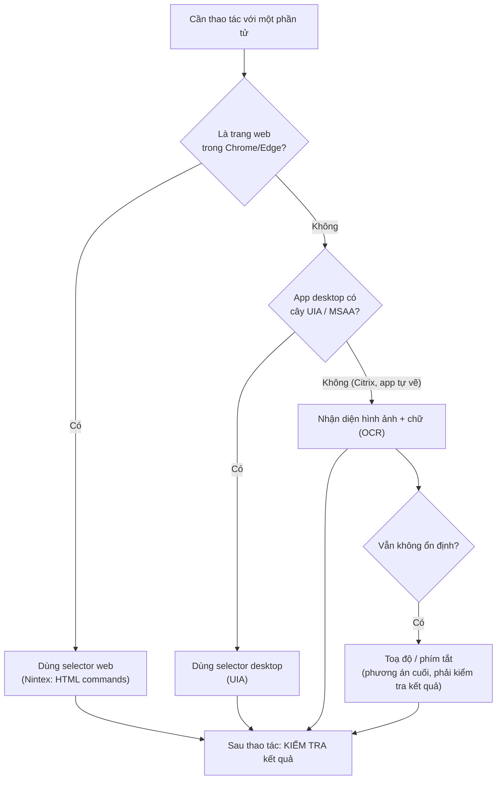

# Bài 03 — Bot nhìn ứng dụng như thế nào

> Module: 01-rpa-fundamentals · Thời lượng: ~85 phút · Cấp độ: L1→L2 · Cập nhật: 2026-11-18

## 1. Mục tiêu bài học
Sau bài này, bạn có thể:
- **Giải thích** 4 cách bot "nhìn" và tìm phần tử trên màn hình: **selector** (theo cấu trúc), **nhận diện hình ảnh**, **OCR**, **toạ độ**.
- **So sánh** độ bền của từng cách và nói được *cái gì làm gãy* mỗi cách.
- **Mô tả** cách Nintex Studio nhận diện đối tượng: Image and text, match threshold, search area, 3 tiêu chí Unique/Static/Clean, và HTML Object Selector cho web.
- **Viết** selector ổn định và nhận ra selector giòn trên một trang web mô phỏng.
- **Phân biệt** "click hụt" (lỗi rõ ràng) với "click nhầm" (thành công giả), và liệt kê nguyên nhân thường gặp.

## 2. Tại sao cần học?
Khi một bot RPA hỏng, lý do số một thường rất đơn giản: **bot không tìm thấy nút cần bấm**, hoặc **bấm nhầm chỗ**. Người trong nghề gọi vui là bot "click hụt".

Bài 01 đã nói RPA **giòn** (*fragile*): giao diện đổi một chút là bot hỏng. Bài này giải thích *vì sao* nó giòn, và *làm sao* để bớt giòn.

Với bot phân quyền user của bạn, hậu quả không chỉ là "bot dừng". Nếu bot bấm nút "Cấp quyền" ở **dòng của người khác**, bot vẫn báo "thành công", nhưng thực tế đã **cấp quyền sai người**. Đó là sự cố bảo mật. Bài 01 bạn đã gặp khái niệm "thành công giả" — hôm nay ta sẽ thấy nó xảy ra thế nào.

**Tin tốt:** bạn là dev frontend. Bạn đã dùng `document.querySelector()`, đã mở DevTools soi DOM hàng ngày. Một nửa bài này là thứ bạn đã biết, chỉ đổi tên gọi.

## 3. Kiến thức cần có trước
- Bài 01 — RPA là gì: [`01-rpa-la-gi.md`](01-rpa-la-gi.md) (RPA thao tác qua giao diện, tính "giòn").
- Bài 02 — Kiến trúc nền tảng RPA: [`02-kien-truc-nen-tang-rpa.md`](02-kien-truc-nen-tang-rpa.md) (Studio record wizard, robot chạy wizard, unattended robot chạy trên VM).
- Từ nền frontend: DOM, CSS selector, `querySelector`, DevTools, render bất đồng bộ (*async*).

## 4. Giải thích khái niệm

### 4.1. Người nhìn màn hình khác bot nhìn màn hình thế nào?

Bạn nhìn màn hình và thấy ngay "nút Cấp quyền ở dòng Trần Thị B". Bot thì không "hiểu" màn hình. Bot cần một **cách mô tả** để tìm lại đúng chỗ đó mỗi lần chạy.

**Ví dụ đời thường: nhờ shipper giao hàng tới nhà bạn.** Có 4 cách chỉ đường:

| Cách chỉ đường | Tương ứng trong RPA |
|---|---|
| "Số 12, ngõ 5, phố Láng Hạ" — theo **địa chỉ** | **Selector** — tìm theo cấu trúc và thuộc tính |
| "Nhà có cổng sắt màu xanh như trong ảnh này" — theo **ảnh** | **Nhận diện hình ảnh** (*image recognition*) |
| "Đọc biển trên cửa, chỗ nào ghi 'Nhà Lan' là đúng" — theo **chữ** | **OCR** — đọc chữ từ ảnh màn hình |
| "Từ đầu ngõ đi thẳng 200 bước, rẽ trái 30 bước" — theo **toạ độ** | **Click theo toạ độ** (*coordinates*) |

Nghĩ một chút: nếu nhà bạn sơn lại cổng, cách nào hỏng? Nếu đầu ngõ xây thêm một nhà, cách nào hỏng? Đó chính là bài toán "bot click hụt".

### 4.2. Cách 1 — Selector trên web (dựa vào DOM)

**Selector** (*bộ chọn*) là một mô tả giúp bot tìm đúng một phần tử giao diện, dựa vào **cấu trúc** (cha–con) và **thuộc tính** (*attribute*) của nó.

Bạn đã quen với điều này:

```js
document.querySelector('tr[data-user="tran.thi.b"] button.grant')
```

Câu này nghĩa là: "tìm thẻ `<tr>` có `data-user` bằng `tran.thi.b`, rồi tìm bên trong nó một `<button>` có class `grant`".

Các công cụ RPA làm y hệt, chỉ khác cách viết. Ví dụ UiPath lưu selector dưới dạng **XML**. Tài liệu UiPath định nghĩa: selector lưu *"the attributes of a graphical user interface element and its parents, in the shape of an XML fragment"* — tức là thuộc tính của phần tử **và của các phần tử cha**, dưới dạng một đoạn XML. Node cuối là phần tử cần tìm, các node trước là cha của nó.

Minh hoạ (kiểu UiPath, đơn giản hoá):
```xml
<html app='chrome.exe' title='Quản trị phân quyền' />
<webctrl tag='BUTTON' aaname='Cấp quyền' />
```
→ "trong cửa sổ Chrome có tiêu đề *Quản trị phân quyền*, tìm nút có chữ *Cấp quyền*".

**Selector nào tốt?** UiPath nhấn mạnh: *"It is important to pick attributes with a constant value"* — phải chọn thuộc tính **không đổi**. Nếu giá trị đổi mỗi lần mở app, selector sẽ không tìm được phần tử.

| Selector | Ổn định? | Vì sao |
|---|---|---|
| `#btn-8f3a2c` (id tự sinh) | ❌ Giòn | Nhiều framework tự sinh id mới mỗi lần render |
| `button.grant` (thứ 2 trong danh sách) | ❌ Rất nguy hiểm | Thứ tự dòng đổi → bấm **nhầm người** |
| `tr[data-user="tran.thi.b"] button.grant` | ✅ Tốt | Gắn với dữ liệu nghiệp vụ (username) không đổi |
| Nút có chữ "Cấp quyền" trong dòng có chữ "tran.thi.b" | ✅ Khá tốt | Chữ ít đổi, nhưng sẽ gãy nếu app đổi ngôn ngữ |

Mẹo nghề: selector tốt nhất thường **neo vào dữ liệu nghiệp vụ** (username, mã đơn) chứ không neo vào vị trí hay id kỹ thuật.

### 4.3. Cách 1b — Selector trên app desktop (Microsoft UI Automation)

App desktop Windows không có DOM. Vậy bot đọc cấu trúc ở đâu?

Windows có sẵn một "DOM cho app desktop", tên là **Microsoft UI Automation** (viết tắt **UIA**). Microsoft mô tả UIA là *"an accessibility framework"* — một **framework trợ năng**. Nó được làm ra để phần mềm đọc màn hình (cho người khiếm thị) biết trên màn hình có gì. Tài liệu cũng nói rõ UIA *"allows automated test scripts to interact with the UI"* — tức là cho cả script tự động thao tác giao diện. Bot RPA tận dụng chính điều này.

UIA trình bày app thành **cây phần tử** (giống cây DOM). Mỗi phần tử có các thuộc tính để nhận diện, quan trọng nhất là:

| Thuộc tính UIA | Giống gì bên web | Ghi chú |
|---|---|---|
| `AutomationId` | `id` | Dev của app đặt; thường ổn định nhất (nếu dev có đặt) |
| `Name` | chữ hiển thị / `aria-label` | **Bị dịch theo ngôn ngữ hệ điều hành** → Windows tiếng Việt và tiếng Anh cho giá trị khác nhau |
| `ControlType` | tên thẻ (`button`, `input`) | Button, Edit, List, Window... |
| `ClassName` | `class` | Tên lớp kỹ thuật của control |

Chi tiết "`Name` bị dịch" lấy từ tài liệu Microsoft: nhóm thuộc tính phải hiển thị *"in the language of the operating system"*, trong đó có `Name`. Hệ quả thực tế: bot record trên máy Windows tiếng Anh có thể gãy khi chạy trên máy Windows tiếng Việt.

Ngoài UIA còn có **MSAA** (*Microsoft Active Accessibility*) — công nghệ cũ hơn, dùng cho app rất cũ (VB6, Win32 cổ). Power Automate hỗ trợ cả hai và khuyên dùng UIA khi có thể.

**Khi nào không có cây phần tử?** Một số trường hợp bot **không đọc được cấu trúc**:
- App chạy qua **Citrix / Remote Desktop**: bot chỉ thấy một "bức ảnh" của màn hình từ xa.
- App tự vẽ giao diện (game, một số app đồ hoạ, một số app cũ).
- Dev không khai báo thông tin trợ năng cho control.

Khi đó, bot phải dùng cách 2.

### 4.4. Cách 2 — Nhận diện hình ảnh (*image recognition*)

Ý tưởng: lúc record, công cụ **chụp ảnh** phần tử (ví dụ ảnh nút "Cấp quyền"). Lúc chạy, robot **chụp màn hình** và tìm vùng nào **giống** ảnh đã lưu, rồi click vào đó.

"Giống" đến mức nào thì chấp nhận? Đó là **match threshold** (*ngưỡng khớp*), tính bằng %. Ngưỡng cao → đòi giống gần như y hệt (an toàn nhưng dễ "không tìm thấy"). Ngưỡng thấp → dễ tìm thấy nhưng dễ **nhận nhầm** sang một chỗ khác trông na ná.

**Ưu điểm:** dùng được với *mọi* thứ hiển thị trên màn hình, kể cả Citrix.
**Nhược điểm:** phụ thuộc vào **cách màn hình hiển thị**. Những thứ làm gãy:
- Độ phân giải màn hình khác (máy dev Full HD, VM robot 1366×768).
- **Scaling/DPI** của Windows (100% vs 125%), **zoom** của trình duyệt.
- Theme sáng/tối, màu nút đổi khi rê chuột (*hover*) hoặc khi bị vô hiệu hoá.
- Có popup/thông báo **che** mất phần tử.
- Màn hình có **hai chỗ trông giống nhau** (ví dụ 4 nút "Cấp quyền" y hệt nhau trên 4 dòng!).

Điểm cuối rất quan trọng với bot phân quyền: 4 nút "Cấp quyền" trông **giống hệt nhau**. Chỉ nhìn ảnh nút thì bot không thể biết nút nào thuộc dòng nào. Phải kết hợp thêm thông tin xung quanh (chữ "tran.thi.b" ở cùng dòng).

### 4.5. Cách 3 — OCR (đọc chữ từ ảnh)

**OCR** (*Optical Character Recognition* — nhận dạng ký tự quang học) chuyển **ảnh có chữ** thành **chữ** (text). Bot dùng OCR để:
1. **Đọc dữ liệu** từ màn hình không cho copy (ví dụ app chạy qua Citrix).
2. **Xác nhận vị trí**: "nút này đúng là nút có chữ *Cấp quyền*, cạnh chữ *tran.thi.b*".

Rủi ro: OCR có thể đọc sai — `0` thành `O`, `1` thành `l`, và **dấu tiếng Việt** dễ bị đọc sai hoặc mất. Vì vậy dữ liệu đọc bằng OCR luôn cần kiểm tra lại (ví dụ đối chiếu với danh sách username hợp lệ).

### 4.6. Cách 4 — Click theo toạ độ

"Click vào điểm (x=840, y=312) trên màn hình." Không quan tâm ở đó có gì.

Đây là cách **giòn nhất**: chỉ cần cửa sổ dịch đi vài pixel, đổi độ phân giải, hay thêm một dòng vào bảng là bot bấm vào chỗ khác — và **không hề báo lỗi**. Tài liệu Power Automate nói thẳng: dùng UI element (selector) để *không cần* "image recognition or absolute coordinates".

Chỉ dùng toạ độ khi không còn cách nào khác, và luôn kèm bước **kiểm tra kết quả** sau khi click.

### 4.7. Bảng so sánh 4 cách

| Tiêu chí | Selector (web/UIA) | Hình ảnh | OCR | Toạ độ |
|---|---|---|---|---|
| Độ bền | Cao nhất (nếu chọn thuộc tính ổn định) | Trung bình | Trung bình (dùng kèm) | Rất thấp |
| Tốc độ | Nhanh | Chậm hơn (phải quét ảnh) | Chậm | Nhanh |
| Cần app "lộ" cấu trúc? | Có (DOM / cây UIA) | Không | Không | Không |
| Dùng được qua Citrix? | Thường là không | Có | Có | Có |
| Gãy khi | Thuộc tính đổi (id tự sinh, đổi ngôn ngữ), cấu trúc đổi | Đổi độ phân giải/DPI/zoom/theme, bị che, có hình trùng | Font/độ nét kém, dấu tiếng Việt | Bất cứ thứ gì dịch chuyển |
| Kiểu lỗi hay gặp | Không tìm thấy (lỗi rõ ràng) | Không tìm thấy **hoặc nhận nhầm** | Đọc sai chữ | **Click nhầm, không báo lỗi** |

**Thứ tự ưu tiên chung** (áp dụng cho mọi công cụ RPA):



Lưu ý ô cuối: dù dùng cách nào, sau một thao tác quan trọng (cấp quyền) bot nên **kiểm tra lại** (ví dụ đọc lại dòng log "Đã cấp quyền cho: tran.thi.b"). Ta sẽ học kỹ ở bài 06.

### 4.8. Nintex Studio "nhìn" ứng dụng thế nào?

Đây là phần riêng của Nintex RPA — công cụ bạn sẽ dùng ở công ty. Thông tin dưới đây lấy từ docs Nintex bản 22.03–24.4; khi có quyền dùng Studio, ta sẽ kiểm tra lại trên bản công ty đang chạy.

**a) Mặc định: nhận diện bằng hình ảnh + chữ.**
Khi bạn record một wizard, mỗi bước có một **core action** (*hành động chính*), mặc định là click. Phần tử bạn click lúc record gọi là **detected object** (*đối tượng được nhận diện*). Lúc chạy, robot phải tìm lại đối tượng đó trên màn hình.

Trong **Detection Match Configuration**, có hai phương pháp:
- **Image and text** (mặc định): dùng ảnh của đối tượng, chữ **bên trong** nó và chữ **xung quanh** nó.
- **Text only**: chỉ dùng chữ bên trong đối tượng.

Các ngưỡng khớp:

| Ngưỡng | Nghĩa | Mặc định (theo docs) |
|---|---|---|
| **Image match** | Ảnh đối tượng giống ảnh lúc record bao nhiêu % | 84%. Docs: **không khuyến nghị** hạ dưới 70% vì robot có thể click nhầm vùng |
| **Inner text match** | Chữ *bên trong* đối tượng (đọc bằng OCR) khớp bao nhiêu % | Khoảng 60–80% tuỳ độ dài chữ; có thể tắt |
| **Outer text match** | Chữ *xung quanh* (đọc bằng OCR) — dùng để **xác nhận vị trí khi có hình giống nhau ở gần** | 50%; nên tắt nếu chữ xung quanh thay đổi |

Thấy chưa? **Outer text match** chính là lời giải cho bài toán "4 nút Cấp quyền giống hệt nhau": robot dùng chữ xung quanh (ví dụ username cùng dòng) để chọn đúng nút. Nhưng nếu chữ xung quanh là dữ liệu *thay đổi* mỗi lần chạy, bạn phải thiết kế khác — ta sẽ học ở module 04.

**Search area** (*vùng tìm kiếm*) — robot tìm đối tượng ở đâu:
- **Click**: chỉ tìm quanh vị trí đã click lúc record.
- **Click, Stripe**: không thấy thì mở rộng ra một "dải" ngang/dọc (chỉ áp dụng khi có cấu hình docking).
- **Click, Stripe, Full**: vẫn không thấy thì tìm **toàn màn hình**.

Docs khuyên dùng vùng **nhỏ nhất** mà vẫn chạy ổn định — vùng nhỏ thì nhanh hơn và ít nhận nhầm hơn.

Còn một tuỳ chọn đáng nhớ: **Auto adjust offset for web browsers** — tự điều chỉnh theo **mức zoom của trình duyệt**. Điều này cho thấy zoom là nguyên nhân gãy phổ biến đến mức Nintex phải làm hẳn tuỳ chọn riêng.

**b) Ba tiêu chí của một đối tượng "dễ nhận diện".**
Docs Nintex yêu cầu detected object phải:
- **Unique** (*duy nhất*): không có "anh em sinh đôi" giống hệt hoặc gần giống trong cửa sổ.
- **Static** (*tĩnh*): hình dạng không (hoặc hiếm khi) thay đổi.
- **Clean** (*sạch*): không bị cắt mất một phần, không chứa vùng trống thừa, chữ thừa, đường kẻ thừa.

Nếu đối tượng không đạt, docs khuyên dùng **offset** (*độ lệch*): nhận diện một đối tượng *đạt chuẩn* ở gần, rồi click lệch đi một khoảng cố định từ đó. Ví dụ: nhận diện chữ "tran.thi.b" (duy nhất), rồi click lệch sang phải tới cột "Thao tác".

**c) Web: HTML commands dùng selector.**
Với trang web, Nintex có nhóm **HTML commands** (Click on HTML Object, Does HTML Object Exist, Get HTML Object Text, Set HTML Object Value...). Các lệnh này dùng **HTML Object Selector** của Nintex để chọn phần tử — tức là đi theo cấu trúc DOM như cách 1. Yêu cầu: cài **Nintex RPA Connector Extension**, trình duyệt **Chrome** hoặc **Edge (Chromium)**.

Ngoài ra Nintex còn có nhóm **UI Automation Commands** cho app desktop (cách 1b). Chi tiết dùng thế nào: học ở module 04–05.

**Kết luận cho bot phân quyền của bạn** (app web admin): ưu tiên **HTML commands** (selector) thay vì click theo ảnh. Đây là quyết định thiết kế quan trọng — bạn sẽ ghi nó vào tài liệu SDD sau này.

### 4.9. Vì sao bot "click hụt" — và "click nhầm"?

Có hai kiểu thất bại, mức độ nguy hiểm rất khác nhau:

| Kiểu | Biểu hiện | Mức nguy hiểm |
|---|---|---|
| **Click hụt** | Bot không tìm thấy phần tử → báo lỗi, dừng | Phiền, nhưng **an toàn**: biết ngay là hỏng |
| **Click nhầm** | Bot tìm thấy *một* phần tử, nhưng **sai phần tử** → vẫn báo "thành công" | **Nguy hiểm**: thành công giả, sai dữ liệu, có thể sai quyền |

Năm nhóm nguyên nhân thường gặp:

| Nhóm | Ví dụ | Hay gây ra |
|---|---|---|
| 1. Phần tử thay đổi | Id tự sinh, app cập nhật đổi giao diện, đổi ngôn ngữ (`Name` bị dịch) | Click hụt |
| 2. Chưa sẵn sàng (*timing*) | Bảng còn đang tải, bot đã tìm nút | Click hụt |
| 3. Môi trường hiển thị khác | Độ phân giải/DPI/zoom/theme khác giữa máy record và VM robot | Click hụt (ảnh) hoặc click nhầm (toạ độ) |
| 4. Phần tử không duy nhất | 4 nút "Cấp quyền" giống nhau; chọn theo vị trí "nút thứ 2" | **Click nhầm** |
| 5. Bị che / không hiển thị | Popup, thông báo, cửa sổ khác đè lên; màn hình bị khoá | Click hụt hoặc click nhầm vào popup |

**Nhóm 2 (timing)** chắc bạn quen rồi: trong Vue, bạn cũng không đọc DOM trước khi component render xong (`nextTick`, `await`). Bot cũng vậy: phải **chờ phần tử xuất hiện** (có giới hạn thời gian — *timeout*), không phải chờ cứng 5 giây rồi hy vọng.

## 5. Thực hành từng bước
> Môi trường: trình duyệt Chrome hoặc Edge, trên máy Windows hoặc Mac đều được. App mô phỏng là file HTML chạy local, không cần mạng. Chi phí: miễn phí.
> File lab: [`assets/03-selector-lab.html`](assets/03-selector-lab.html) — một trang "Quản trị phân quyền" giả lập: mỗi lần làm mới, **id nút đổi ngẫu nhiên**, **thứ tự dòng bị xáo**, và bảng **xuất hiện sau ~2 giây**. Dữ liệu là giả.

Mục tiêu: bạn đóng vai "bot", dùng Console để thử từng kiểu selector và tự thấy cái nào gãy.

**Bước 1 — Mở app mô phỏng**

Mở file `03-selector-lab.html` bằng Chrome/Edge (kéo thả file vào trình duyệt, hoặc chuột phải → Open with). Nếu bạn học trên máy Windows, copy file từ repo sang (qua git clone, USB, hoặc copy nội dung file).

Kết quả mong đợi: thấy dòng "Đang tải dữ liệu...", khoảng 2 giây sau hiện bảng 4 user, mỗi dòng có nút "Cấp quyền".

**Bước 2 — Soi phần tử bằng DevTools**

Chuột phải vào một nút "Cấp quyền" → **Inspect** (hoặc F12). Nhìn thẻ HTML của nút và dòng chứa nó.

Kết quả mong đợi (id của bạn sẽ khác):
```html
<tr data-user="tran.thi.b">
  ...
  <td><button class="grant" id="btn-c09da1">Cấp quyền</button></td>
</tr>
```
Giải thích: đây là những "manh mối" bot có thể dùng: `id`, `class`, chữ "Cấp quyền", và thuộc tính `data-user` của dòng cha.

**Bước 3 — Selector theo id: chạy được... một lần**

Mở tab **Console**. Copy id của nút đầu tiên bạn thấy ở bước 2, chạy (thay id của bạn vào):
```js
document.querySelector('#btn-c09da1')
```
Kết quả mong đợi: Console in ra thẻ `<button class="grant" id="btn-c09da1">Cấp quyền</button>`.

Giờ bấm nút **"Làm mới danh sách"** trên trang, chờ bảng hiện lại, chạy **lại đúng câu đó**.

Kết quả mong đợi:
```
null
```
Giải thích: id được sinh ngẫu nhiên mỗi lần render. Selector theo id tự sinh → **click hụt** ngay lần chạy sau.

**Bước 4 — Selector theo vị trí: nguy hiểm thầm lặng**

Chạy:
```js
document.querySelectorAll('button.grant')[1].closest('tr').dataset.user
```
Giải thích: lấy nút "Cấp quyền" **thứ 2** (chỉ số `[1]`), rồi hỏi "nút này thuộc dòng của user nào?".

Kết quả mong đợi: một username, ví dụ `'tran.thi.b'`.

Bấm "Làm mới danh sách", chờ bảng hiện, chạy lại câu trên **2–3 lần** (mỗi lần làm mới một lần).

Kết quả mong đợi: username **thay đổi** giữa các lần, ví dụ `'nguyen.van.a'`.

Giải thích: selector này **luôn tìm thấy** một nút — không bao giờ báo lỗi. Nhưng mỗi lần là nút của **người khác**. Nếu bot click vào đó, nó sẽ cấp quyền sai người mà vẫn báo "thành công". Đây chính là **click nhầm / thành công giả**.

**Bước 5 — Selector neo vào dữ liệu nghiệp vụ**

Chạy:
```js
document.querySelector('tr[data-user="tran.thi.b"] button.grant').click()
```
Kết quả mong đợi: nút trên dòng `tran.thi.b` đổi thành "Đã cấp", và dưới bảng hiện:
```
Đã cấp quyền 'Xem báo cáo' cho: tran.thi.b
```
Làm mới danh sách vài lần rồi chạy lại: lần nào cũng đúng dòng `tran.thi.b`, dù thứ tự và id đã đổi.

Giải thích: selector này neo vào `data-user` — giá trị gắn với **dữ liệu nghiệp vụ** (username), không đổi theo id hay vị trí. Trên app thật, không phải lúc nào cũng có `data-user`; khi đó ta neo vào **chữ** trong ô username (giống "outer text" của Nintex).

**Bước 6 — Timing: tìm quá sớm**

Chạy hai dòng này **cùng lúc** (dán cả hai rồi Enter):
```js
document.querySelector('#lc-refresh').click();
document.querySelector('tr[data-user="tran.thi.b"] button.grant')
```
Kết quả mong đợi:
```
null
```
Giải thích: dòng 1 bấm "Làm mới", bảng bị xoá và đang "tải". Dòng 2 tìm nút **ngay lập tức** → chưa có → `null`. Selector đúng, nhưng tìm **quá sớm**.

Giờ dán hàm "chờ phần tử xuất hiện" này vào Console:
```js
async function waitFor(selector, timeoutMs = 5000) {
  const start = Date.now();
  while (Date.now() - start < timeoutMs) {
    const el = document.querySelector(selector);
    if (el) return el;
    await new Promise(r => setTimeout(r, 200)); // thử lại mỗi 200 ms
  }
  throw new Error("Không tìm thấy " + selector + " sau " + timeoutMs + " ms");
}
```
Rồi chạy:
```js
document.querySelector('#lc-refresh').click();
await waitFor('tr[data-user="tran.thi.b"] button.grant')
```
Kết quả mong đợi: sau khoảng 2 giây, Console in ra `<button class="grant" id="btn-...">Cấp quyền</button>`.

Thử thêm với user không tồn tại:
```js
await waitFor('tr[data-user="khong.ton.tai"] button.grant', 1000)
```
Kết quả mong đợi (lỗi màu đỏ):
```
Uncaught Error: Không tìm thấy tr[data-user="khong.ton.tai"] button.grant sau 1000 ms
```
Giải thích: đây là cách mọi công cụ RPA "chờ": hỏi đi hỏi lại tới khi thấy, quá **timeout** thì báo lỗi rõ ràng. Báo lỗi rõ ràng **tốt hơn** nhiều so với chạy tiếp mà không biết mình đang làm gì.

**Bước 7 — Zoom: selector không sợ, ảnh thì sợ**

Nhấn `Ctrl` + `+` (Mac: `Cmd` + `+`) vài lần để zoom trang lên 150%. Chạy lại lệnh ở bước 5 (sau khi làm mới danh sách).

Kết quả mong đợi: vẫn tìm đúng và click đúng dòng `tran.thi.b`.

Giải thích: selector đọc **DOM**, không đọc **pixel**, nên zoom không ảnh hưởng. Còn nếu bot lưu *ảnh* nút ở zoom 100%, thì ở 150% nút to hơn, ảnh không còn khớp → có thể click hụt. Đó là lý do Nintex có tuỳ chọn "Auto adjust offset for web browsers".

**Bước 8 (tuỳ chọn, chỉ trên Windows) — Nhìn "cây UIA" của app desktop**

Microsoft có công cụ **Accessibility Insights for Windows** (mã nguồn mở, tải tại https://accessibilityinsights.io/docs/windows/overview/). Chế độ **Live Inspect** cho xem thuộc tính UI Automation của phần tử khi rê chuột lên.

Bước này là **cài phần mềm lên máy cá nhân của bạn** — chỉ làm nếu bạn muốn. Nếu cài: mở Notepad hoặc Calculator, bật Live Inspect, rê chuột lên một nút, tìm các thuộc tính `Name`, `ControlType`, `AutomationId`. So sánh với bảng ở mục 4.3.

**Dọn dẹp**
- Nhấn `Ctrl` + `0` (Mac: `Cmd` + `0`) để trả zoom về 100%.
- Đóng tab lab. Không có tài nguyên nào khác được tạo.

## 6. Lỗi thường gặp
| Triệu chứng / thông báo lỗi | Nguyên nhân | Cách xử lý |
|---|---|---|
| Bot chạy tốt trên máy dev, lỗi "object not found" trên VM robot | Độ phân giải / DPI scaling / zoom khác nhau (nhận diện bằng ảnh) | Đồng bộ độ phân giải và scaling giữa máy record và VM; ưu tiên selector thay vì ảnh |
| Lần đầu chạy được, lần sau "không tìm thấy phần tử" | Selector dùng thuộc tính tự sinh (id ngẫu nhiên, số phiên) | Đổi sang thuộc tính ổn định: `data-*`, name, chữ hiển thị, dữ liệu nghiệp vụ |
| Bot báo thành công nhưng dữ liệu sai dòng | Selector theo vị trí, hoặc ảnh không duy nhất (nhiều nút giống nhau) | Neo vào dữ liệu nghiệp vụ (username); Nintex: dùng outer text / offset từ đối tượng duy nhất; thêm bước kiểm tra kết quả |
| Lúc lỗi lúc không (lỗi "chập chờn") | Timing: tìm phần tử khi trang chưa tải xong; dùng chờ cứng (sleep) | Dùng "chờ tới khi xuất hiện" có timeout, không dùng sleep cố định |
| Bot click vào popup / thông báo thay vì nút cần bấm | Popup bất ngờ che phần tử | Thêm bước kiểm tra và đóng popup trước khi thao tác; xử lý ngoại lệ (bài 06) |
| Bot gãy khi chạy trên máy cài Windows ngôn ngữ khác | Thuộc tính `Name` (UIA) bị dịch theo ngôn ngữ hệ điều hành | Ưu tiên `AutomationId`; thống nhất ngôn ngữ hệ điều hành của VM robot |
| Nintex: hạ image match xuống thấp cho "chạy được" rồi click nhầm | Ngưỡng < 70% — docs Nintex không khuyến nghị | Giữ ngưỡng ≥ 70%; sửa đối tượng cho đạt Unique/Static/Clean hoặc dùng offset |
| Lab: dán code vào Console bị chặn, trình duyệt yêu cầu gõ chữ cho phép dán | Tính năng chống lừa đảo của Chrome/Edge với người lần đầu dán code | Làm theo hướng dẫn trên Console (gõ dòng chữ cho phép) rồi dán lại |

## 7. Thuật ngữ
| Tiếng Anh | Nghĩa tiếng Việt | Giải thích ngắn |
|---|---|---|
| Selector | Bộ chọn | Mô tả giúp bot tìm đúng một phần tử, dựa vào cấu trúc và thuộc tính |
| Attribute | Thuộc tính | Thông tin gắn với phần tử (id, class, name, data-*...) |
| Dynamic attribute | Thuộc tính động | Thuộc tính đổi giá trị mỗi lần chạy (vd id tự sinh) — không nên dùng trong selector |
| Microsoft UI Automation (UIA) | (giữ nguyên) | Framework trợ năng của Windows, trình bày app desktop thành cây phần tử cho bot đọc |
| MSAA (Microsoft Active Accessibility) | (giữ nguyên) | Công nghệ trợ năng cũ hơn UIA, dùng cho app rất cũ |
| AutomationId / Name / ControlType | (giữ nguyên) | Thuộc tính UIA: mã định danh / tên hiển thị (bị dịch theo ngôn ngữ) / loại control |
| Accessibility | Trợ năng | Hỗ trợ người khuyết tật dùng máy tính; RPA tận dụng hạ tầng này |
| Image recognition | Nhận diện hình ảnh | Tìm phần tử bằng cách so khớp ảnh đã lưu với màn hình |
| Match threshold | Ngưỡng khớp | % giống tối thiểu để robot chấp nhận đã tìm thấy đối tượng |
| OCR (Optical Character Recognition) | Nhận dạng ký tự quang học | Chuyển ảnh có chữ thành chữ |
| Coordinates | Toạ độ | Vị trí (x, y) trên màn hình; click theo toạ độ là cách giòn nhất |
| Core action | Hành động chính | Hành động được record của một bước trong wizard Nintex (mặc định: click) |
| Detected object | Đối tượng được nhận diện | Phần tử đã click lúc record, robot phải tìm lại lúc chạy |
| Image and text / Text only | Ảnh và chữ / Chỉ chữ | Hai phương pháp nhận diện trong Nintex Detection Match Configuration |
| Inner text / Outer text | Chữ bên trong / Chữ xung quanh | Chữ trong đối tượng / chữ quanh đối tượng, đọc bằng OCR để xác nhận |
| Search area (Click / Stripe / Full) | Vùng tìm kiếm | Nơi robot Nintex tìm đối tượng: quanh điểm click / một dải / toàn màn hình |
| Unique / Static / Clean | Duy nhất / Tĩnh / Sạch | 3 tiêu chí Nintex cho một đối tượng dễ nhận diện |
| Offset | Độ lệch | Click lệch một khoảng cố định từ một đối tượng dễ nhận diện ở gần |
| HTML Object Selector | Bộ chọn đối tượng HTML | Công cụ chọn phần tử web của Nintex, dùng trong HTML commands |
| Nintex RPA Connector Extension | Tiện ích kết nối trình duyệt | Extension cần cài để Nintex điều khiển Chrome/Edge |
| Timeout | Thời gian chờ tối đa | Quá thời gian này mà chưa thấy phần tử thì báo lỗi |
| Click hụt / Click nhầm | (thuật ngữ nội bộ khoá học) | Không tìm thấy phần tử (lỗi rõ) / tìm thấy nhưng sai phần tử (thành công giả) |
| DPI scaling | Tỉ lệ hiển thị | Thiết lập phóng to giao diện của Windows (100%, 125%...) — làm đổi kích thước ảnh trên màn hình |

## 8. Đọc tài liệu gốc
> Nguồn: Nintex RPA — Detection Match Configuration: https://help.nintex.com/en-US/kryonrpa/24.4/Content/Studio/CoreActions/Detection_Match_Configuration.htm

**Các câu trích (tiếng Anh, nguyên văn, lấy từ các phần khác nhau của trang):**
> "The higher the match threshold percentage, the closer the match required."
> "If the specified match threshold(s) are not met, the step will fail."
> "Decreasing the image match threshold below 70% is not recommended, and in some cases restricted."
> "If the minimum threshold is less than 70%, the robot might click the wrong area of the screen, in which case you must increase the percentage so that the wizard will run properly."

**Giải thích từng câu:**
1. *"The higher the match threshold percentage, the closer the match required."*
   → "Phần trăm ngưỡng khớp càng cao, thì mức giống nhau đòi hỏi càng sát."
   Cấu trúc **"The higher …, the closer …"** = "càng … thì càng …". Rất hay gặp trong tài liệu kỹ thuật.
2. *"If the specified match threshold(s) are not met, the step will fail."*
   → "Nếu (các) ngưỡng khớp đã đặt không được đáp ứng, bước đó sẽ thất bại."
   **specified** = đã chỉ định/đã đặt. **are not met** = không được đáp ứng (*meet a requirement* = đáp ứng yêu cầu). Đây là **click hụt** — lỗi rõ ràng.
3. *"Decreasing the image match threshold below 70% is not recommended, and in some cases restricted."*
   → "Hạ ngưỡng khớp ảnh xuống dưới 70% là không được khuyến nghị, và trong một số trường hợp bị chặn."
   **Decreasing** = việc giảm. **not recommended** = không khuyến nghị. **restricted** = bị giới hạn/không cho phép.
4. *"If the minimum threshold is less than 70%, the robot might click the wrong area of the screen, in which case you must increase the percentage so that the wizard will run properly."*
   → "Nếu ngưỡng tối thiểu nhỏ hơn 70%, robot có thể click vào sai vùng màn hình; khi đó bạn phải tăng phần trăm lên để wizard chạy đúng."
   **might** = có thể (không chắc chắn). **in which case** = trong trường hợp đó. **so that** = để mà. Đây chính là **click nhầm**.

**Từ/cụm từ đáng nhớ:** *match threshold* (ngưỡng khớp), *the higher …, the closer …* (càng … càng …), *not met* (không đạt), *not recommended* (không khuyến nghị), *restricted* (bị giới hạn), *in which case* (khi đó), *properly* (đúng cách).

## 9. Tự kiểm tra
1. Kể tên 4 cách bot tìm phần tử trên màn hình. Cách nào bền nhất, cách nào giòn nhất? Vì sao?
2. Bot phân quyền của bạn được record trên laptop (màn hình 1920×1080, scaling 125%). Khi đưa lên VM robot (1366×768, scaling 100%), bot báo "object not found" ở bước click nút "Cấp quyền". Bot đang dùng cách nhận diện nào? Bạn sửa thế nào?
3. Đồng nghiệp viết selector `document.querySelectorAll('button.grant')[0]` và nói "chạy 10 lần đều không lỗi, ổn rồi". Bạn trả lời họ thế nào?
4. Chuyện gì xảy ra nếu, để bot "đỡ lỗi", bạn hạ Image match trong Nintex từ 84% xuống 55%?
5. App cần tự động hoá chạy qua Citrix (bot chỉ thấy hình ảnh màn hình). Bạn chọn cách nhận diện nào, và cần cẩn thận điều gì?

<details><summary>Gợi ý đáp án (chỉ mở sau khi đã tự trả lời)</summary>

1. Selector (web DOM / desktop UIA), nhận diện hình ảnh, OCR, toạ độ. **Selector** bền nhất (nếu chọn thuộc tính ổn định) vì đọc cấu trúc, không phụ thuộc pixel. **Toạ độ** giòn nhất vì bất cứ thứ gì dịch chuyển cũng làm bot bấm sai chỗ, và không báo lỗi.
2. Gần như chắc chắn là **nhận diện bằng hình ảnh**: độ phân giải và scaling khác nhau làm ảnh nút trên VM khác ảnh lúc record → không đạt match threshold → click hụt. Sửa: (a) với web admin, chuyển sang **HTML commands** (selector), không phụ thuộc pixel; (b) nếu buộc phải dùng ảnh, đồng bộ độ phân giải + scaling giữa máy record và VM, rồi record lại.
3. "Không lỗi" chưa chắc là "đúng". Selector theo vị trí **luôn tìm thấy** một nút, nhưng thứ tự dòng có thể đổi (sắp xếp, thêm user mới) → bot cấp quyền **nhầm người** mà vẫn báo thành công. Cần kiểm tra: nút đó có đúng thuộc dòng của user cần cấp không. Nên neo selector vào username.
4. Robot dễ "tìm thấy" hơn, nhưng là tìm thấy **những thứ chỉ hơi giống** → dễ click nhầm vùng màn hình. Docs Nintex: dưới 70% không được khuyến nghị (có trường hợp bị chặn), robot có thể click sai vùng. Đổi click hụt (an toàn) thành click nhầm (nguy hiểm) là đổi tệ hơn. Cách đúng: sửa đối tượng cho đạt Unique/Static/Clean, dùng offset, hoặc đổi sang selector.
5. Không có DOM/cây UIA → dùng **nhận diện hình ảnh + OCR**. Cẩn thận: cố định độ phân giải/scaling của phiên Citrix; chọn đối tượng duy nhất, tĩnh, sạch; dùng chữ xung quanh để phân biệt các nút giống nhau; kiểm tra dữ liệu đọc bằng OCR (dấu tiếng Việt, 0/O); luôn kiểm tra kết quả sau khi thao tác. Nếu có thể, hỏi xem có cách khác không qua Citrix (API, truy cập trực tiếp).
</details>

## 10. Nguồn tham khảo
| Tài liệu | Phiên bản | Ngày truy cập |
|---|---|---|
| [Nintex RPA — Detection Match Configuration](https://help.nintex.com/en-US/kryonrpa/24.4/Content/Studio/CoreActions/Detection_Match_Configuration.htm) | Nintex RPA 24.4 (URL); ảnh trong trang ghi 22.03 | 2026-11-18 |
| [Nintex RPA — Object Detection Criteria](https://help.nintex.com/en-us/kryonrpa/22.03/content/studio/ObjectDetection/Object_Detection_Criteria.htm) | Nintex RPA 22.03 | 2026-11-18 |
| [Nintex RPA — Detected Object Types](https://help.nintex.com/en-US/kryonrpa/24.4/Content/Studio/ObjectDetection/Detected_Object_Types.htm) | Nintex RPA 24.4 (URL) | 2026-11-18 |
| [Nintex RPA — Object Detection](https://help.nintex.com/en-US/kryonrpa/22.03/Content/Studio/ObjectDetection/Object_Detection.htm) | Nintex RPA 22.03 | 2026-11-18 |
| [Nintex RPA — HTML Commands](https://help.nintex.com/en-US/kryonrpa/24.4/Content/AdvancedCommands/HTMLCommands/HTML_Commands.htm) | Nintex RPA 24.4 | 2026-11-18 |
| [Microsoft — UI Automation (Win32)](https://learn.microsoft.com/en-us/windows/win32/winauto/entry-uiauto-win32) | cập nhật 2025-07-14 | 2026-11-18 |
| [Microsoft — UI Automation Properties Overview](https://learn.microsoft.com/en-us/dotnet/framework/ui-automation/ui-automation-properties-overview) | .NET Framework docs | 2026-11-18 |
| [Microsoft — Power Automate: Automate using UI elements](https://learn.microsoft.com/en-us/power-automate/desktop-flows/ui-elements) | cập nhật 2026-05-14 | 2026-11-18 |
| [UiPath — About Selectors (UI Automation activities)](https://docs.uipath.com/activities/other/latest/ui-automation/about-selectors) | latest | 2026-11-18 |
| [Accessibility Insights for Windows — Overview](https://accessibilityinsights.io/docs/windows/overview/) | — | 2026-11-18 |

**Chưa xác minh:**
- Thuật toán so khớp ảnh chi tiết của Nintex (docs không mô tả).
- Thuộc tính cụ thể mà HTML Object Selector của Nintex lưu lại (id? class? XPath?) — trang HTML Object Selector chưa đọc; sẽ kiểm tra ở module 05.
- Ví dụ selector XML kiểu UiPath ở mục 4.2 là **minh hoạ đơn giản hoá**, không phải output thật từ UiPath Studio.
- Các giá trị mặc định (84%, 50%, 70%) lấy từ docs bản 22.03–24.4; bản Nintex công ty đang dùng có thể khác.
