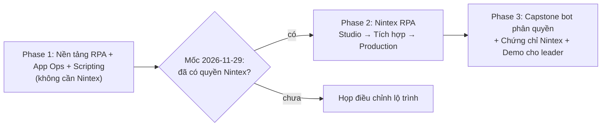

# Lộ trình: App Operations dùng RPA — trọng tâm Nintex RPA

> Dựa trên: `research/skills-matrix.md` (2026-11-16) + `research/nintex-product-facts.md` + `learner/profile.md`
> Thời gian học: 20h/tuần (chỉ học ở nhà) · Bắt đầu: 2026-11-16 · Dự kiến hoàn thành giai đoạn 1: 2027-01-15
> Giai đoạn 2 (sau thử việc, chưa lập chi tiết): UiPath hoặc Power Automate + chứng chỉ UiPath — làm mới nghiên cứu thị trường trước khi lập.

## Tổng quan

| Phase | Module | Tầng | Cấp độ đích | Giờ ước tính | Tuần | Cần Nintex? | Mốc chứng chỉ |
|---|---|---|---|---|---|---|---|
| 1 | 01-rpa-fundamentals | Cốt lõi (khái niệm) | L3 | 12 | 1 (16–22/11) | Không | — |
| 1 | 02-app-ops-access | Nền tảng bổ sung | L3 | 10 | 2 (23–26/11) | Không | — |
| 1 | 03-automation-scripting | Quan trọng (Python, REST/JSON, SQL) | L3 | 24 | 2–3 (26/11–6/12) | Không | — |
| 2 | 04-nintex-studio | Cốt lõi | L3 | 20 | 4 (7–13/12) | **Có** | — |
| 2 | 05-nintex-integrations | Cốt lõi | L3 | 22 | 5 (14–20/12) | **Có** | — |
| 2 | 06-nintex-production | Cốt lõi | L4 | 18 | 6 (21–27/12) | **Có** | — |
| 3 | 07-capstone-access-bot | Cốt lõi | L4 | 30 | 7–8 (28/12–10/1) | **Có** | — |
| 3 | 08-nintex-cert | Chứng chỉ | L3 | 10 | 8–9 (5–15/1) | **Có** | nintex-rpa-developer |

Tổng: ~146h học + ~20% ôn tập ≈ **175h ≈ 8,7 tuần** ở 20h/tuần → vừa khít 2 tháng, **không có thời gian dự phòng**. Nếu chậm: cắt bớt bài L1 của module 06 (tích hợp Nintex Automation Cloud) và thu gọn module 08.

### Phụ thuộc quan trọng: quyền truy cập Nintex
- Phase 2–3 cần Nintex RPA Studio kết nối tới một RPA Server có license (xem `research/nintex-product-facts.md`, `research/nintex-pricing.md`). Mua cá nhân không khả thi.
- Việc của người học trong tuần 1–2: gửi đề xuất cho leader xin tài khoản Studio trên môi trường dev/test + tài khoản Nintex University; giữ phương án trial 30 ngày (chỉ kích hoạt khi sẵn sàng vào Phase 2).
- **Mốc kiểm tra 2026-11-29**: chưa có quyền → họp điều chỉnh (dời Phase 2, hoặc kéo dài Phase 1 với bài tập sát công việc hơn, hoặc xem xét lại công cụ thực hành tạm thời).
- Ổ cứng máy Windows: cần dọn ≥ 50 GB trống (yêu cầu chính thức của Studio) trước Phase 2.

## Miễn học (dựa trên bài kiểm tra đầu vào)
| Chủ đề | Kết quả kiểm tra | Quyết định |
|---|---|---|
| Git | Chưa kiểm tra — 4 năm frontend | Không đưa thành module; quiz 5 câu khi bắt đầu module 03 (dùng Git để quản lý script) |
| HTTP, JSON, DOM/CSS selector, JavaScript | Chưa kiểm tra — thế mạnh nghề frontend | Không học lại; dùng làm "cầu nối" trong bài 01-03, 03-03, 03-07, 05-01 |

## Phase 1 — Nền tảng (không cần Nintex)

**Mục tiêu phase**: hiểu RPA đủ để nói chuyện ngang hàng với leader; mô tả và thiết kế được quy trình phân quyền theo chuẩn vận hành; tự viết script tự động hoá bằng Python (Excel → REST API → báo cáo) — kỹ năng sẽ dùng lại trong Nintex (Run Script, REST, JSON, SQL).

### Module 01-rpa-fundamentals — Nền tảng RPA (L3)
- **Vì sao cần**: nhóm "RPA platform" có trong 97,6% tin; khái niệm dùng chung cho Nintex, UiPath, Power Automate.
- **Bài học**: `modules/01-rpa-fundamentals/README.md`
- **Bài tập bắt buộc**: ex01 đánh giá & chấm điểm quy trình ứng viên tự động hoá · ex02 viết PDD cho quy trình phân quyền
- **Definition of Done**:
  - [ ] Chấm điểm ≥ 5 quy trình theo ma trận tiêu chí, chọn 1 quy trình có tính ROI (giờ tiết kiệm/tháng)
  - [ ] PDD quy trình phân quyền có As-Is, To-Be, ngoại lệ (≥ 5), số liệu ước tính
  - [ ] Quiz module ≥ 80%

### Module 02-app-ops-access — Vận hành ứng dụng & quản lý truy cập (L3)
- **Vì sao cần**: người học mới vào App Ops; bot đầu tiên là bot phân quyền — bot có quyền cao, sai là sự cố bảo mật.
- **Bài tập bắt buộc**: ex01 ma trận quyền (RBAC) + quy trình To-Be có kiểm soát · ex02 runbook vận hành bot phân quyền
- **Definition of Done**:
  - [ ] Ma trận role–permission cho hệ thống mô phỏng, có ít nhất 1 cặp SoD (phân tách nhiệm vụ)
  - [ ] Runbook xử lý ≥ 4 tình huống sự cố bot
  - [ ] Quiz module ≥ 80%

### Module 03-automation-scripting — Python, dữ liệu, REST API, SQL (L3)
- **Vì sao cần**: Python 39%, REST API 46%, SQL 44% tin; Nintex có Run Script (Python), Call REST API, Query JSON, Database commands.
- **Môi trường lab**: `lc-admin` — web admin mô phỏng (user, role, request phân quyền) có UI + REST API, chạy local; mentor dựng khi giao bài tập module 03.
- **Bài tập bắt buộc**: ex01 lab Excel → REST API → báo cáo · ex02 debug script tự động hoá lỗi · ex03 tự động hoá giao diện web lc-admin (selector + wait) không hướng dẫn từng bước
- **Definition of Done**:
  - [ ] Script xử lý file request mẫu (≥ 20 dòng, có dòng lỗi) → cấp quyền đúng qua API, 0 cấp sai, file báo cáo + log đầy đủ, chạy lại không cấp trùng (idempotent)
  - [ ] Tìm và sửa ≥ 4/5 lỗi cài sẵn trong bài debug
  - [ ] Quiz module ≥ 80%

### Cuối Phase 1
- **Mini-project**: "Bản đề xuất RPA cho leader" — 1 trang: quy trình chọn, PDD tóm tắt, ROI, rủi ro, kế hoạch triển khai bằng Nintex.
- **Mini interview**: `/phong-van mini 1` (giả lập leader hỏi về đề xuất RPA)

## Phase 2 — Nintex RPA (cần quyền truy cập Nintex)

**Mục tiêu phase**: tự xây wizard Nintex thao tác web/desktop/Excel/email/API, xử lý lỗi, publish và vận hành bot.

### Module 04-nintex-studio — Nintex Studio căn bản (L3)
- **Bài tập bắt buộc**: ex01 wizard đầu tiên trên lc-admin · ex02 debug wizard hỏng do đổi giao diện
- **Definition of Done**:
  - [ ] Wizard đăng nhập lc-admin, tìm user, đọc thông tin, có biến + điều kiện + vòng lặp, chạy 3 lần liên tiếp thành công
  - [ ] Quiz module ≥ 80%

### Module 05-nintex-integrations — Web, Excel, Email, API, Database (L3)
- **Bài tập bắt buộc**: ex01 bot phân quyền v1 (Excel → web lc-admin → email) · ex02 bot phân quyền qua REST API + JSON
- **Definition of Done**:
  - [ ] Bot v1 xử lý file 20 request, kết quả khớp đáp án; credential lấy từ Credentials Vault, không hard-code
  - [ ] Quiz module ≥ 80%

### Module 06-nintex-production — Đưa bot vào vận hành (L4)
- **Bài tập bắt buộc**: ex01 xử lý sự cố kiểu production · ex02 thiết kế vận hành 200 request/ngày (queue, trigger, attended vs unattended)
- **Definition of Done**:
  - [ ] Bot chịu được 5 loại lỗi cài sẵn (web chậm, user không tồn tại, role không hợp lệ, file sai định dạng, mất phiên đăng nhập) mà không dừng cả lô
  - [ ] Quiz module ≥ 80%

### Cuối Phase 2
- **Mini interview**: `/phong-van mini 2` (kỹ thuật Nintex + xử lý sự cố)

## Phase 3 — Capstone, chứng chỉ, demo

### Module 07-capstone-access-bot — Bot phân quyền end-to-end (L4)
Xem mục Capstone bên dưới.

### Module 08-nintex-cert — Nintex RPA Developer Certification
- Thông tin đề thi **chưa xác minh** (trang Nintex University cần đăng nhập) → khi có tài khoản, chạy `/luyen-thi` để viết exam-guide và domain-map.

## Mốc chứng chỉ
| Chứng chỉ | Sau module | Dự kiến thi | Chi tiết |
|---|---|---|---|
| Nintex RPA Developer Certification | 06 (+08 ôn) | 2027-01 (tuần 9) | `certifications/plan.md` |

## Capstone
**"Access Request Bot" cho lc-admin** — mô phỏng đúng bài toán thật ở công ty (không dùng dữ liệu công ty):
- Đầu vào: request phân quyền (Excel/email) → kiểm tra hợp lệ (user tồn tại, role hợp lệ, có phê duyệt, không vi phạm SoD) → cấp quyền trên web admin (UI) hoặc API → gửi email thông báo → ghi log + báo cáo ngày.
- Hồ sơ đi kèm: PDD, SDD, test case UAT (≥ 15 case), runbook, slide demo 5 phút cho leader có ROI.
- Tiêu chí đạt: 100% case UAT đúng; không cấp sai quyền; lỗi đơn lẻ không làm dừng cả lô; không có credential trong wizard/repo; demo trả lời được câu hỏi trade-off (UI vs API, attended vs unattended).

## Final
- Demo capstone + `/phong-van full` (giả lập leader + kỹ thuật) — đạt ≥ 75% hai lần liên tiếp.

## Lịch sử điều chỉnh
| Ngày | Thay đổi | Lý do |
|---|---|---|
| 2026-11-16 | Tạo lộ trình | Onboarding |
